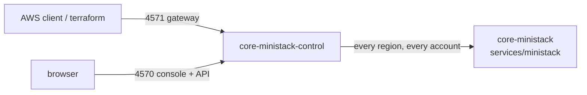

# ministack-control

The control plane for the MiniStack emulator: the AWS gateway, the accounts and
sessions, the console and the bucket registry. It is what makes a local emulator
rehearse a production Terraform deployment (`my-portfolio`) without touching a
real AWS account.

The emulator itself is a separate service and a separate repository —
[`services/ministack`](../ministack). This one never contains it: the emulator is
an upstream image, the control plane is ours.

| Field | Value |
| --- | --- |
| Tier | `core` |
| Containers | `core-ministack-control` (gateway + console) and the optional `core-ministack-control-stackport` browser |
| Depends on | `core-ministack` (the emulator, `services/ministack`) on `net-services` at `http://core-ministack:4566` |
| Endpoints | `https://ministack.mus.com` (console/API) · `https://aws.mus.com` (AWS gateway); the same ports stay published on loopback (`4570`/`4571`) |
| Data | `/srv/myinfra/containers/ministack/data/control` (accounts, sessions, registry, audit) |
| Restart | `"no"` — on demand, not in the always-on set |

## Topology



**There is exactly one emulator, and that is the whole point.** MiniStack is a
single process in which each request carries a region (from the SigV4 credential
scope) and an account (from a 12-digit access key), with state partitioned by
both. Regions and accounts are *configuration*, not containers: adding a region
or a second account is a console action plus a client credential.

| What | Where it comes from | Configured by |
| --- | --- | --- |
| Region | the SigV4 scope (`.../us-west-1/s3/aws4_request`), else `MINISTACK_REGION` | `MINISTACK_REGIONS` (the advertised set) + per-account opt-in |
| Account | a 12-digit access key, else `MINISTACK_ACCOUNT_ID` | this control's account store |
| State | partitioned per account; per region for every service except S3 and Aurora DSQL | the emulator (`services/ministack`) |

S3 and Aurora DSQL are **account-scoped but not region-isolated** (an upstream
limitation): two regions within one account see the same buckets. That matches
`ListBuckets`, but do not expect per-region S3 clones.

The emulator is not published on the host; the control reaches it at
`http://core-ministack:4566` over `net-services`.

### Credentials

There are no pre-baked AWS profiles. Credentials come from the console: sign
in, and **Settings → Access keys** lists this account's **IAM access keys** by
name, each with a masked ID and a masked secret. Create one to get the pair once
(secret shown a single time, with **Download .csv**), delete one to revoke it.
An account holds **at most two** keys, so a rotation can overlap: create the
new key, switch the client, then delete the old one. Point any client at
`https://aws.mus.com` (Traefik, lab wildcard certificate) —
`http://127.0.0.1:4571` still works for anything that cannot resolve lab names.

A 12-digit access key is that account's **root** and accepts any secret; an
`AKIA…` key is verified by IAM. Because regions are not configured, the region
a request uses is simply the one the client signs with.

## Retired: per-region containers

The first cut ran one emulator and one ledger agent **per region** and federated
them (`central`/`mesh`/`quorum`, gossip, per-node ledgers). MiniStack already
isolates state per region and account, so that layer was redundant and is gone:
`compose.yml` starts one node, `NodeRegistry.ensure_static` seeds it from
`MINISTACK_NODE_URL` and never expires it, and `MINISTACK_CONTROL_MODE`,
`MINISTACK_JOIN_TOKEN`, `MINISTACK_MESH_TOKEN`, `NODE_TTL_SECONDS` and
`AGENT_POLL_SECONDS` no longer drive anything. `control/agent.py` and the mode
labels stay in the tree as history, not as a supported path.

## Gateway (`https://aws.mus.com`)

The single AWS entrypoint. It reads the **SigV4 signing region** (or
`X-Ministack-Region` for unsigned callers) and the access key, then forwards to
the one emulator, which does the region/account partitioning itself.

What the control adds is **one global bucket-name registry**, keyed by bucket
name, so a name cannot exist in two accounts or two regions — AWS keeps S3 names
unique partition-wide.

- `CreateBucket` is **reserved atomically** and recorded against the requesting
  account (from the access key); a second claim gets `409 BucketAlreadyExists`,
  whichever account or region asks.
- `DeleteBucket` on success releases the name.
- The registry is rebuilt from the emulator's `ListBuckets` at startup, on
  `POST /api/refresh`, and by the 10s poller. That listing is **per account**
  (the root account), so a reconcile prunes only that account's entries and
  never drops another account's buckets; an inventory that cannot be read is
  kept and marked `stale` rather than dropped.

If the emulator is down the gateway answers `503 ServiceUnavailable` instead of
hanging.
> [!NOTE]
> Use **path-style** S3 addressing (the provider flag `s3_use_path_style =
> true`, already used by `local.tfvars`). Virtual-hosted requests are parsed
> best-effort. Presigned SigV4 credentials in the query string are honoured too.

## Tokens and authentication

| Credential | Where | What it protects |
| --- | --- | --- |
| `MINISTACK_ADMIN_TOKEN` | `.env` | Scripted API access (`Bearer`); writes refuse without a session or this token. |
| `MINISTACK_ADMIN_USER` / `MINISTACK_ADMIN_PASSWORD` | `.env` | Bootstrap local admin, seeded **only when the user store is empty**. |
| `MINISTACK_REGIONS` | `.env` | `all` (default) or a comma list; the regions this instance will accept. A new account still starts with `us-east-1` only. |
| `MINISTACK_SMTP_*` | `.env` | Password-reset mail; the same relay Grafana uses. Empty host hides `/forgot`. |
| `OIDC_ADMIN_ROLE` | `.env` | Client role that makes an OIDC identity a global admin (default `global-admin`). |
| `OIDC_CLIENT_SECRET` | `.env` (written by `scripts/keycloak-realm.sh`) | OIDC code exchange. |

On a fresh database the `MINISTACK_ADMIN_USER`/`MINISTACK_ADMIN_PASSWORD` pair is
seeded as the **default global admin**; every later account is created by that
admin or by sign-up (when enabled). No other account comes from `.env`.

Generate them once (never commit `.env`):

```sh
python3 -c "import secrets; print(secrets.token_hex(24))"
```

The control's tokens are **not** AWS credentials — they gate the control plane
only. Back up the control directory; it holds every account, session and key.

## Login and access

There is no direct access to the backend stack. The emulator publishes no host
port; the only ways in are the dashboard (`4570`) and the AWS gateway (`4571`),
and the dashboard requires a session.

- Sign in at <https://ministack.mus.com/login> (or <http://127.0.0.1:4570/login>)
  with the seeded `.env` admin, another local user, or Keycloak. Sessions are
  server-side, `HttpOnly` cookies, 8h by default, persisted across restarts and
  extended on activity.
- Scripted API access uses `Authorization: Bearer <MINISTACK_ADMIN_TOKEN>`
  instead of a session. The gateway (`4571`) is SigV4 and needs no session.

### Local users (SQLite)

`data/control/users.db` holds usernames, PBKDF2-SHA256 password hashes (260k
rounds) and the account each user belongs to. Tenancy stays in `accounts.json`;
the database answers only "is this password right, and which account is this".

| Page | What it does |
| --- | --- |
| `/login` | email-or-username + password in the Grafana-style card, “Forgot password?”, and the IdP button below the divider |
| `/forgot`, `/reset?token=…` | emails a single-use reset link (30 min) and sets the new password; the reset drops that account's sessions |
| `/signup` | creates an account (fresh 12-digit ID, unique alias) and signs in; **the first one becomes the default global admin**. Link-free by design — reachable only when sign-up is enabled |
| `/login/iam` | account ID/alias + IdP, for a principal that already belongs to another account |

### Password reset (SMTP)

`/forgot` is only offered when `MINISTACK_SMTP_HOST` is set; the settings come
from the same relay Grafana uses (`MINISTACK_SMTP_*` in `.env`, empty in
`.env.example`). The token is stored only as a SHA-256 hash in `users.db`
(`password_resets`), is single-use, expires after `MINISTACK_RESET_TTL_SECONDS`,
and a new request retires the previous link. The page answers the same generic
sentence whether or not the address exists, so it cannot be used to enumerate
accounts. Reset links point at `MINISTACK_PUBLIC_URL`.

The control seeds **nothing** from `.env`. The first account created — by local
sign-up or by the first Keycloak sign-in — is the platform owner: `global_admin`
and `default_admin` are set on it, and it can promote other accounts to global
admin from **Accounts**. From then on the database and `accounts.json` are the
source of truth; there is no env-var password to change. SQLite is deliberate for
one control replica: swap `_connect` for Postgres when a second one runs.

**Retiring the default admin.** The default admin is meant to be temporary. Once
a second enabled global admin exists, the Dashboard shows a banner to disable or
delete it. `POST /api/accounts/{id}/disabled` disables an account; disabling the
last enabled global admin is refused, and disabling an account also drops its
sessions and blocks local/OIDC sign-in. Sign-up itself can be turned on or off
in **Settings** (`/api/settings`, `signup_enabled`).

### Audit trail

Identity and tenancy changes append to `data/control/audit.jsonl`: account
created/deleted, global-admin grant/revoke, account disabled/enabled, region
enabled/disabled, sign-up toggle and credential issue/rotation. Each entry has
`at`, `actor`, `action`, `target` and `detail`; global admins read it at
`GET /api/audit?limit=100` and in **Accounts → Audit trail**.

### OpenTelemetry

With `OTEL_EXPORTER_OTLP_ENDPOINT` set (e.g. `http://otel-collector:4318`), the
control exports OTLP/HTTP JSON spans (`POST /v1/traces`) for every request,
propagating an incoming `traceparent` and recording method, path and status.
Unset, it is a no-op and there is no dependency to install.

### Accounts and identities

An **account** is the tenancy boundary — the 12-digit ID a client signs as.
Humans are never accounts: they are principals inside one.

| Path | What it does |
| --- | --- |
| **Local user** (`/login`, `/signup`) | password verified against `users.db`; a signup mints the account and its alias |
| **Sign in with Keycloak** (`/oidc/start?intent=root`) | resolves the subject to its account; the first login claims a migrated, unbound root |
| **Create an account with Keycloak** (`?intent=signup`) | makes a new account with a fresh 12-digit ID, that subject as root |
| **Account ID or alias** (`/login/iam`) | requires the subject to already be a principal in that account, else `403 not a member` |

The two paths meet in the same account: a local user and an OIDC subject can
both be principals of one account, and each gets its own IAM access key.

`data/control/accounts.json` is v2: `accounts` keyed by ID, plus `subjects`
mapping an OIDC `sub` to an account. A v1 file (`{username: account_id}`) is
migrated on load — the username becomes the alias and its unbound root, so the
next Keycloak login claims it. That is how the existing `mathewmusango`
account (`111111111111`) survived the change.

`GET /api/accounts/me` returns the session's `user`, `account`, `alias` and
`role`.

### Credentials and IAM

`AUTH=true`, so the emulator **verifies** IAM-user signatures and evaluates
their policies. Two kinds of credential exist, and they are not the same thing:

| Credential | How it identifies the account | Verified? |
| --- | --- | --- |
| a **12-digit access key** (the account ID) | from the key itself | no — root; any secret is accepted, so `test`/`test` still works |
| an **IAM access key** (`AKIA…`) | from IAM state inside that account | yes — secret, session token and request time |

On the first sign-in for a principal the control creates the IAM user, attaches
a `ministack-admin` inline policy (`Action: *`, `Resource: *`) and mints one
access key — `issue_credentials()` in `control/app.py`. The console manages the
rest in **Settings → Access keys** through `GET`/`POST /api/credentials`:
`action: create` (with a `name`), `delete` (with `access_key_id`) or `rotate`
(delete every key, then create `primary`). The store is a list per principal and
the cap is two keys per account — `create_access_key()` refuses before it calls
the emulator, so a refused request never leaves an orphan key behind. The flat
`access_key_id` / `secret_access_key` fields mirror the first key, which is what
the classic pages and the provision response still read. Same-account calls are
then a real, enforced identity:

```sh
aws --endpoint-url https://aws.mus.com sts get-caller-identity
# Arn: arn:aws:iam::111111111111:user/mathewmusango
```

The gateway **preserves the client's `Host` header** on purpose: SigV4 covers
it, so rewriting it to the container name would fail every verified request with
`SignatureDoesNotMatch`.

Provisioning calls use the account ID as a root key, which is why the control can
set up IAM in any account without holding a long-lived secret. A principal's
issued secret lives in `accounts.json`, which is why that file is `0600` and
never leaves the host.

### OIDC (Keycloak, with OpenBao available)

`MINISTACK_AUTH_MODE` is `local` (default), `oidc` or `both`. With OIDC the
login page offers **Sign in with Keycloak**; `/oidc/callback` completes an
authorization-code flow with PKCE and reads the profile from `/userinfo` (no
JWT signature validation; the tokens travel over TLS).

- `OIDC_STYLE` — `keycloak` (live) or `openbao` (OpenBao's `identity/oidc`
  provider discovery).
- `OIDC_PUBLIC_URL` — `https://keycloak.mus.com` (browser redirect).
- `OIDC_INTERNAL_URL` — `http://security-keycloak:8080` (discovery, token and
  userinfo from the control container; lab names resolve to 127.0.0.1 inside
  containers, so the container never uses the public hostname).
- `OIDC_REALM` — `my-labs`; `OIDC_CLIENT_ID` — `ministack-control`.
- Endpoints come from the realm's discovery document and the token/userinfo URLs
  are rewritten onto `OIDC_INTERNAL_URL`, so switching IdPs is config only.
  `OIDC_DISCOVERY_URL` / `OIDC_AUTHORIZE_URL` override either URL outright.

The realm `my-labs` and client `ministack-control` are created by
`scripts/keycloak-realm.sh`. The realm user `mathewmusango` has a password (set
in the Keycloak console) — required before the OIDC button works. The live
client is exported to `addons/keycloak/client.json` by
`../keycloak/scripts/export-clients.py`; the export is a snapshot and never
contains the client secret (that stays in `.env`).

**Console roles, like Grafana's.** `../keycloak/scripts/setup-ministack-roles.py`
adds two client roles to `ministack-control` and maps groups onto them:

| Group | Client role | Effect in the console |
| --- | --- | --- |
| `ministack-global-admins` | `global-admin` | the account becomes a global admin at sign-in (cross-account, provisioning, audit) |
| `ministack-users` | `account-user` | a normal account: own tenancy only |

The control reads `resource_access[*].roles` (and `realm_access.roles`) from the
userinfo response, so no extra mapper is needed; `OIDC_ADMIN_ROLE` renames the
elevating role. Elevation happens on sign-in and is audited
(`account.global_admin_granted`, `via: oidc`); removing the role in Keycloak does
not demote by itself — an admin does that from **Accounts**.

**OpenBao alternative.** `../openbao/scripts/setup-oidc-provider.py` also
configures OpenBao as an IdP (scopes `profile`/`email`, the
`ministack-control` client application, provider allow-list) and it was verified
end to end. Its authorize endpoint is OpenBao's **UI** route, so the browser
signs in to OpenBao first; switching means setting `OIDC_STYLE=openbao`,
`OIDC_PUBLIC_URL=https://openbao.mus.com`,
`OIDC_INTERNAL_URL=http://security-openbao:8200`, `OIDC_PROVIDER=default` and
that client's id/secret in `.env`, then recreating the container.

### Resource browser

`https://ministack.mus.com/resources` is our own browser, not an embed. It
signs each read as that account's 12-digit **root**
(`Credential=<id>/<date>/<region>/<service>/aws4_request`, dummy signature), so
the control holds no AWS secret and can list **every** account — which a
single-credential client like StackPort structurally cannot.

- Three selects: **account** (every account in `accounts.json`, alias + ID),
  **region**, **service** (`BROWSE_SERVICES` in `control/app.py`).
- The "Signed as" line comes from STS `GetCallerIdentity`, so the page proves
  which account actually answered.
- Rows are `kind / name / detail` from the service's list call.
- JSON: `GET /api/browse?account=&region=&service=` — `400` for an unknown
  service or a missing account, `404` for an unknown account.

Coverage: IAM, S3, DynamoDB, SQS, SNS, Lambda, CloudWatch Logs, Secrets
Manager, SSM, Kinesis and Step Functions. Listed shape only for now — no
per-resource drill-down, search or write actions.

> [!NOTE]
> StackPort still runs on demand at `https://stackport.mus.com` for comparison.
> It is being retired: dropping the `stackport` service, its Traefik route and
> network alias leaves `/resources` as the only browser. The `STACKPORT_*`
> variables stay only while that container exists.

## Console and control API (`https://ministack.mus.com`)

The console is a **React SPA** built from `web/` (Cloudscape components, the same
AWS-console design system StackPort uses). The control container serves it at
`/`, so the dashboard, API and gateway share one host.

```sh
cd web && npm ci
npm run typecheck                  # tsc --noEmit (typed api/ + types)
npm test                           # Vitest + Testing Library in jsdom
```

The control image builds the console itself: `Dockerfile` has a Node stage that
runs `npm ci && npm run build` and a Python stage that copies `dist` to
`/app/static`, so the runtime container needs no host build and no bind mounts.
Rebuild after changing `control/` or `web/`:

```sh
podman-compose build ministack-control && podman-compose up -d ministack-control
```

`web/dist` and `web/node_modules` stay gitignored — they are build output, not
sources. The retired server-rendered pages remain reachable at `/classic`.
See [`web/README.md`](web/README.md) for the console's layout, the Cloudscape
pattern-to-screen mapping, the testing setup and the forked dependency repos.
It also records the upstream issue this console is a candidate answer to
([ministackorg/ministack#314](https://github.com/ministackorg/ministack/issues/314)).

Pages: **Dashboard** (`/`), **Resources** (`/resources/:service`), **Favorites**,
**Accounts**, **Onboarding**, **Settings**, **About**.

- **Region selector** — the picker lists the regions the signed-in account
  **enabled** (Settings → Regions; `us-east-1` cannot be disabled). Regions are
  **not** node-based: the single emulator serves every region, so a new account
  starts with `us-east-1` alone and enabling another is one toggle.
- **Credential download** — rotating a key returns `aws_access_key_id` and
  `aws_secret_access_key` once, with **Download .csv**, the same one-time step as
  the AWS console.
- **Tenancy is enforced** — a session may only read or act on **its own** account,
  and only in its enabled regions. `/api/browse`, `/api/exec` and `/api/users`
  return `403` otherwise. The `.env` operator (and the admin bearer token) is the
  one platform administrator that may cross accounts, and it is the only caller
  allowed to provision or delete accounts.
- **Accounts span regions** — a 12-digit account ID is global, exactly like AWS:
  the account selector and the region selector are independent, and one account
  works in every region it enables.
- **Default administrator** — the first account is the platform owner and is
  marked *default*. Once another global admin exists the Dashboard shows a banner
  to disable or delete it; disabling drops its sessions and blocks sign-in, and
  the last enabled global admin cannot be disabled.
- **Actions are CLI calls in a form** — `control/console.py` declares each
  operation, its parameters and the AWS call it maps to. `POST /api/exec` runs it
  signed as the account root, with a confirmation modal for destructive ones.
  Eleven services ship with actions: `s3`, `ec2`, `sqs`, `sns`, `dynamodb`, `iam`,
  `logs`, `secretsmanager`, `ssm`, `kinesis`, `stepfunctions`; every other service
  stays browsable (read-only). Coverage against the 101 upstream services and
  2,519 operations is tracked in [`docs/SERVICES.md`](docs/SERVICES.md), generated
  by `scripts/upstream_services.py`.
- **Resource tabs** — a service whose browse returns several kinds shows one tab
  per kind (IAM users/roles/groups/policies, EC2 instances/security groups/key
  pairs, and so on), each with its own count.
- **Theme** — system default, light or dark, switchable from the top navigation
  and Settings; the system choice follows the OS preference live.
- **Favorites** live in the browser (`localStorage`) and pin services in the top
  navigation.
- **Sessions survive restarts** — live sessions are persisted to
  `data/control/sessions.json` (mode `0600`) and the expiry slides on activity,
  so a container restart or a long working day does not sign you out. Logging
  out removes the token from both memory and the file.
- **Typed API surface** — `web/src/api.ts` and `web/src/types.ts` are
  TypeScript; the rest of the console is still JS via `allowJs`, so the
  migration is file-by-file with `npm run typecheck` as the gate.
- **Rust CLI** — [`cli/`](cli/README.md) builds `ministackctl`, a typed operator
  for the same API (whoami, accounts, browse, exec, s3-ls), with the token read
  from a file/env and TLS verification left on.
- **Dashboard** — recently visited and favorite services first (each with its
  service icon), endpoint health (console, gateway, emulator), services
  answering, total resources and control uptime.
- **Services** — `/services` lists every service the emulator knows, with a
  label (acronyms upper-case, the rest CamelCase), availability, resource count
  and favorites. Each service opens its own page with a **sidebar of resource
  kinds** (IAM users/roles/groups/policies, EC2 instances/security groups/key
  pairs, …), the action form and the table. The account root is called out as
  not being an IAM user.
- **No Resources page** — the old grouped `/resources` view is gone; `/resources`
  redirects to Services and `/resources/:service` stays as the service detail
  URL.
- **S3 row actions** — select a bucket (radio) and **Delete** it with a
  confirmation modal, or **Create bucket** from the table header; both go
  through `POST /api/exec` like the action form.
- **Region picker** — grouped like the AWS console: friendly name and code, a
  count of regions not enabled, and **Manage regions** jumps to Settings.
- **Onboarding** provisions an account + local login + IAM key in one step and
  shows the secret once. The inviter stays signed in.

> [!NOTE]
> S3 bucket names are global in MiniStack: a bucket made in one region is visible
> in every region of the same account, and the console says so on the S3 page.
> Every other service is region-isolated.

API responses carry `api_version` (`v1`); routes accept both `/api/...` and
`/api/v1/...`.

| Method | Path | Auth | Purpose |
| --- | --- | --- | --- |
| GET | `/health` | none | control-plane liveness, API version, mode |
| GET | `/login` | none | sign-in page |
| POST | `/login` | credentials | start a session |
| GET | `/logout` | session | end a session |
| GET | `/api/meta` | session/token | product, version, enabled regions, visible accounts, session |
| GET | `/api/actions` | session/token | GUI action catalogue + service groups |
| GET | `/api/counts` | session/token | per-service resource counts for one account/region |
| POST | `/api/exec` | session/token | `{account, region, service, operation, params}` |
| POST | `/api/accounts` | platform admin | provision account + local user + IAM key |
| DELETE | `/api/accounts/{id}` | platform admin | delete account, logins and IAM users |
| POST | `/api/regions` | session/token | enable/disable a region for an account |
| GET | `/api/nodes` | session/token | nodes + last health |
| GET | `/api/services` | session/token | service availability per node |
| GET | `/api/browse` | session/token | resources for one account/region/service |
| GET | `/api/users` | session/token | accounts, principals, key IDs |
| GET | `/api/credentials` | session | this principal's keys (names, masked ID/secret) |
| GET | `/api/buckets` | session/token | global bucket registry |
| GET | `/api/s3` | session/token | registry + inventory/agents |
| POST | `/api/credentials` | session | create, delete or rotate this principal's keys |
| POST | `/api/nodes/register` | join token | node joins/re-registers |
| GET | `/api/nodes/discovery` | join token | peers for agent gossip |
| POST | `/api/refresh` | session/token | reconcile registry from nodes |
| POST | `/api/reserve` | session/token | reserve `{name, region}` |
| DELETE | `/api/buckets/{name}` | session/token | release a name |
| POST | `/api/nodes/{name}/reset` | session/token | reset a node, drop its entries |
| POST | `/api/nodes/heartbeat` | node token | node → control link check |

## Start

Prerequisite: the emulator (`services/ministack`) is running. `up.sh` refuses to
start the gateway without it.

```sh
cp .env.example .env      # set MINISTACK_ADMIN_TOKEN, MINISTACK_ADMIN_USER/PASSWORD
install -d -m 0755 /srv/myinfra/containers/ministack/data/control
./scripts/up.sh           # image build, network, dependency check, start
```

`up.sh` runs `podman-compose build` first: this is our own image
(`localhost/ministack-control:<tag>`, tag from `MINISTACK_CONTROL_TAG`, default
`dev`). The emulator stays the pinned upstream image and lives in its own repo.

The control's data directory defaults to the path it used before the split
(`/srv/myinfra/containers/ministack/data/control`), so accounts, sessions and the
bucket registry survive the move. Set `MINISTACK_CONTROL_DATA_DIR` in `.env` to
point somewhere else — for example
`/srv/myinfra/containers/ministack-control/data` once you have moved the files
with the container stopped.

No `sudo` is needed: `/srv/myinfra/containers` is user-owned on this box.

## Terraform rehearsal (my-portfolio prod)

Values from **Settings → Access keys** (or `GET /api/credentials` after signing
in — the secret itself is only ever returned once, when the key is created).
Write them into your own shell/profile; nothing here is pre-wired:

```sh
cd ~/Workspace/myprojects/my-portfolio/terraform/infra/site

export AWS_ENDPOINT_URL=https://aws.mus.com
export AWS_ACCESS_KEY_ID=<the account's access key>
export AWS_SECRET_ACCESS_KEY=<the matching secret>
export AWS_REGION=us-east-1            # any region; the signature carries it
export TF_VAR_environment=prod TF_VAR_project=my-portfolio
export TF_VAR_aws_region=us-east-1
export TF_VAR_allowed_origin=https://mathewmusango.github.io
export TF_VAR_tags='{"project":"my-portfolio","managed_by":"terraform","repo":"mathewmusango/my-portfolio"}'

aws s3 mb s3://my-portfolio-tfstate-prod   # once per reset
terraform init \
  -backend-config="bucket=my-portfolio-tfstate-prod" \
  -backend-config="key=site/terraform.tfstate" \
  -backend-config="region=us-east-1" \
  -backend-config="encrypt=true"
terraform apply
```

The metrics root follows with `key=metrics/terraform.tfstate`. For a different
region, change `AWS_REGION`/`TF_VAR_aws_region`; S3 state is account-scoped, so
the same bucket name is visible there.

> [!NOTE]
> **Containerised clients cannot use the lab hostnames.** Podman containers get
> the host's router DNS, so `aws.mus.com` resolves publicly (the real mus.com),
> not to Traefik. Add `--add-host aws.mus.com:127.0.0.1` for a client container,
> or use `http://127.0.0.1:4571`. Host tools (Terraform, curl, browsers) use the
> local resolver and need nothing.

## Limits

- The gateway **buffers** request and response bodies (no streaming); fine for
  state files and API payloads, not for multi-GB object transfers.
- Responses that embed a node's own endpoint (e.g. API Gateway execute-api
  URLs) point at that node directly, bypassing the gateway.
- Account **root** keys (the 12-digit ID) are accepted with any secret, by
  design; only issued `AKIA…` keys are verified. The control's own tokens
  authenticate the console, not AWS.
- MiniStack's own S3 home-region behaviour stays intact inside the emulator.

## Operations

```sh
podman-compose ps
podman-compose logs -f
podman-compose down
podman-compose pull && ./scripts/up.sh
```

This stops/starts the **control plane** only. The emulator has its own compose
project; use `services/ministack` for that (`podman-compose -f
../ministack/compose.yml ps`, or `cd ../ministack && ./scripts/up.sh`).

Reset the emulator from the dashboard or `POST /api/nodes/ministack/reset`;
that clears its registry entries and starts the next scan clean.

## Files

- [`compose.yml`](compose.yml) — the control plane (gateway + console) and the
  optional StackPort browser.
- [`control/app.py`](control/app.py) — gateway, console pages, control API.
- [`control/console.py`](control/console.py) — the GUI action catalogue and the
  AWS calls each operation maps to.
- [`docs/POSITIONING.md`](docs/POSITIONING.md) — product direction, naming and the claims not to make (proposed, not decided).
- [`docs/SERVICES.md`](docs/SERVICES.md) · [`docs/services.json`](docs/services.json) — generated upstream service/operation coverage (`scripts/upstream_services.py`).
- [`control/agent.py`](control/agent.py) — retired per-node ledger agent (kept as history).
- [`web/`](web/) — the React + Cloudscape console (its own README).
- [`cli/`](cli/) — the `ministackctl` Rust client.
- [`qa/tasks.json`](qa/tasks.json) — signed-off behaviour with evidence markers; `scripts/qa_check.py` enforces it.
- [`scripts/keycloak-realm.sh`](scripts/keycloak-realm.sh) — realm + OIDC client.
- [`scripts/up.sh`](scripts/up.sh) — build + start the control plane, readiness.
- [`.env.example`](.env.example) — settings; copy to `.env` (gitignored).
- The emulator lives in [`../ministack`](../ministack).

> [!NOTE]
> The fields and naming above come from `services/README.md`. Scaffold new
> services with `./scripts/new-service` rather than copying an existing one.
