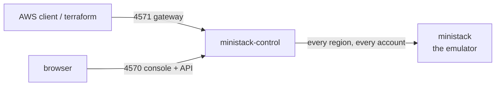

<h1 align="center">Emuplane</h1>
<p align="center"><strong>The control plane, console and gateway for AWS-compatible emulators.</strong></p>
<p align="center">Backend gateway · Accounts, logins and access keys · Console and control API</p>

<p align="center">
  <a href="https://github.com/mathewmusango/emuplane/actions/workflows/release.yml"></a>
  <a href="https://github.com/mathewmusango/emuplane/actions/workflows/semgrep.yml"></a>
  
  
  <a href="https://github.com/users/mathewmusango/packages/container/package/emuplane"></a>
</p>

---

## Why Emuplane?

Emuplane is not an emulator. It is what you put in front of one — MiniStack, Floci,
LocalStack, Moto — so the thing is usable by more than one person:

- It holds the accounts, and the logins inside them.
- It issues the access keys clients sign with. The secret is shown once.
- It is the endpoint AWS clients and Terraform point at.
- It serves the console, the control API and the resource browser.

A backend is a **profile** in [`control/backends.py`](control/backends.py): a display
name, a default port and the quirks worth knowing. `EP_BACKEND` selects the profile
and `EP_BACKEND_URL` is the connection string, so changing backend is a `.env`
change, not a fork of this repository.

The first profile is our fork of MiniStack,
[`mathewmusango/ministack-upstream`](https://github.com/mathewmusango/ministack-upstream),
on `main` (the S3 patch lives there; the old feature branch is docs-only).
It is upstream [`ministackorg/ministack`](https://github.com/ministackorg/ministack)
`v1.5.40` plus S3 region isolation, which upstream does not have yet, published as
`ghcr.io/mathewmusango/ministack-upstream:1.5.40-fork.3-full`.

## Multi-tenancy and regions

MiniStack already partitions state per account and per region, and its own
[README](https://github.com/ministackorg/ministack#readme) covers the mechanics —
the 12-digit access key and the SigV4 scope. This service adds the policy on top:

- **Regions are opt-in per account.** A region the instance does not serve is
  refused; one it serves is enabled on first use. The console lists only the enabled
  regions.
- **Logins belong to accounts.** A person signs in as a principal inside one
  account, with its own IAM user and keys — never as a second account.
- **Neither is a container.** A second account or a new region is one record, not a
  second emulator.

## Plain MiniStack or this fork?

Plain [MiniStack](https://github.com/ministackorg/ministack) already isolates state
per account and per region, for every service except S3. The fork closes that gap:

| S3 behaviour | Plain MiniStack | This fork |
| --- | --- | --- |
| A bucket belongs to | the account, in every region | exactly one account and region |
| `ListBuckets` | every bucket in the account | the signing region's buckets |
| Wrong-region request | reaches the bucket | `301 PermanentRedirect` with `x-amz-bucket-region` |
| State | shared namespace, unique names advised | one record under `(account, region, name)` |

## Compatibility with MiniStack

The fork is upstream `v1.5.40` plus one patch, so everything a client sees stays the
same:

- **Same API and ports.** Every service, operation and wire shape is upstream's;
  nothing is renamed and no endpoint moves.
- **Same configuration.** The `MINISTACK_*` variables keep their names and meanings
  — `AUTH`, `PERSIST_STATE`, `S3_PERSIST`, `MINISTACK_REGION` and the rest.
- **Same image shape.** Built from upstream's `Dockerfile.full`, and the `-full`
  suffix keeps the pin a drop-in for `ministackorg/ministack:<version>-full`.
- **Same duplicate-name behaviour.** AWS's rule for an owner re-create is untouched:
  `200` in us-east-1 with the ACLs reset, `BucketAlreadyOwnedByYou` elsewhere.
- **One visible difference.** S3 state is region-scoped, as the table above shows. A
  client that stays in one region sees no change at all.

| Field | Value |
| --- | --- |
| Runs | `emuplane`: the console, the control API and the AWS gateway |
| Depends on | the MiniStack emulator, a separate service on port `4566` |
| Endpoints | `http://localhost:4570` (console/API) · `http://localhost:4571` (emulator gateway), loopback only |
| Data | none on this host — state lives in the emulator's DynamoDB, provisioned as the `emuplane` CloudFormation stack |
| Restart | `"no"` — on demand, not in the always-on set |

## Versioning and the image

The image is `ghcr.io/mathewmusango/emuplane:<version>`, built and pushed
by [`.github/workflows/release.yml`](.github/workflows/release.yml) on every `v*`
tag, together with the GitHub Release.

| Bump | When | Example |
| --- | --- | --- |
| minor | a feature | `0.1.0` → `0.2.0`, up to `0.10.0` |
| patch | a Dependabot or Renovate PR | `0.1.0` → `0.1.10` |
| major | by hand | `0.1.0` → `1.0.0` |

The git tag carries a `v` (`v0.1.0`); the image tag does not (`0.1.0`). `latest`
follows the newest tag. Nothing is tagged yet — `0.1.0` is the first.

## Topology



**There is exactly one emulator, and that is the whole point.** MiniStack is a
single process in which each request carries a region (from the SigV4 credential
scope) and an account (from a 12-digit access key), with state partitioned by
both. Regions and accounts are *configuration*, not containers: adding a region
or a second account is a console action plus a client credential.

| What | Where it comes from | Configured by |
| --- | --- | --- |
| Region | the SigV4 scope (`.../us-west-1/s3/aws4_request`), else `MINISTACK_REGION` | the per-account opt-in, chosen from the supported set |
| Account | a 12-digit access key, else `MINISTACK_ACCOUNT_ID` | this control's account store |
| State | partitioned per account; per region for every service, S3 included on the fork image; Aurora DSQL stays account-scoped | the emulator image |

S3 is region-isolated on the fork image: a bucket lives in one region,
`ListBuckets` answers with the signing region's buckets, and a request signed for
another region gets the `301 PermanentRedirect` AWS returns. Aurora DSQL remains
**account-scoped but not region-isolated** (an upstream limitation): two regions
within one account see the same state.

The emulator is not published on the host; the control reaches it at
`MINISTACK_NODE_URL` (`http://ministack:4566` on a shared compose network).

### Credentials

There are no pre-baked AWS profiles. Credentials come from the console: sign
in, and **Settings → Access keys** lists this account's **IAM access keys** by
name, each with a masked ID and a masked secret. Create one to get the pair once
(secret shown a single time, with **Download .csv**), delete one to revoke it.
An account holds **at most two** keys, so a rotation can overlap: create the
new key, switch the client, then delete the old one. Point any client at
`https://ministack.example.com` (a reverse proxy in front of the published
port, with `aws.example.com` kept as a deprecated alias), or at
`http://127.0.0.1:4571` directly.

A 12-digit access key is that account's **root** and accepts any secret; an
`AKIA…` key is verified by IAM. The region a request uses is the one the client
signs with, and the gateway only accepts it once the account has enabled that
region.

## One emulator, not a federation

The first cut ran one emulator and one ledger agent **per region** and federated
them (gossip, per-node ledgers, quorum). MiniStack already isolates state per
region and account, so that layer was redundant: the emulator is one process and
the control takes its address from `MINISTACK_NODE_URL` — no join, heartbeat,
expiry, mode or peer gossip. The registration endpoints,
`MINISTACK_CONTROL_MODE`, `MINISTACK_JOIN_TOKEN`, `MINISTACK_MESH_TOKEN` and
`NODE_TTL_SECONDS` are removed with `control/agent.py`.

## Gateway (`https://ministack.example.com`)

The single AWS entrypoint. It reads the **SigV4 signing region** (or
`X-Ministack-Region` for unsigned callers) and the access key, then forwards to
the one emulator, which does the region/account partitioning itself.

A request is refused (`403 AccessDenied`) when the account that owns the signing
key has not enabled the region it signed for — **except** for a region this
instance still serves (the catalogue): that one is enabled on first use and
recorded in the account's `auto_regions`, so Settings shows
*enabled on first use* next to it. A region the instance does not advertise is
always refused. Unsigned callers and keys the control does not know are
forwarded untouched.

What the control adds is **one global bucket-name registry**, keyed by bucket
name, so a name cannot exist in two accounts or two regions — AWS keeps S3 names
unique partition-wide.

- `CreateBucket` is **reserved atomically** and recorded against the requesting
  account (from the access key); a second claim gets `409 BucketAlreadyExists`,
  whichever account or region asks. The one exception is the owner re-creating a
  bucket in its own region: that request is forwarded, so the emulator answers
  AWS's `200` (us-east-1, ACLs reset) or `BucketAlreadyOwnedByYou`.
- `DeleteBucket` on success releases the name.
- The registry is rebuilt from the emulator's `ListBuckets` at startup, on
  `POST /api/refresh`, and by the 10s poller. That listing is **per account**
  (the root account), so a reconcile prunes only that account's entries and
  never drops another account's buckets; an inventory that cannot be read is
  kept and marked `stale` rather than dropped.

If the emulator is down the gateway answers `503 ServiceUnavailable` instead of
hanging.
> [!NOTE]
> Use **path-style** S3 addressing (the provider flag `s3_use_path_style =
> true`, already used by `local.tfvars`). Virtual-hosted requests are parsed
> best-effort. Presigned SigV4 credentials in the query string are honoured too.

## Tokens and authentication

**Settings use the `EP_` prefix** and nothing else: backend, addresses, ports and
the store all share it, so a value's owner is obvious at a glance. The backend's
own settings keep its names in its own `.env` — Emuplane never writes there.

| Credential | Where | What it protects |
| --- | --- | --- |
| API bearer token | **nowhere in `.env`** | Scripted API access (`Bearer`); writes refuse without a session or this token. `./scripts/token.sh` mints one, prints it once and stores only a SHA-256 hash in the settings store — the same contract as a session, and no credential in a file that gets copied or pasted. |

**There is no seeded account.** A fresh control has zero accounts and one way in:
sign-up (`/signup`), exactly as a new AWS account is created by the person who
wants it. **No account is a global administrator**: root owns its own account and
its IAM users, exactly as in AWS, and one account never sees another. The only
principal that may cross tenancies is the bearer token, which is a deployment
credential, not a login. Earlier versions seeded an `MC_ADMIN_USER` and granted
`global_admin`; those keys are retired, and the flag is cleared on load.

### Settings (`.env`)

The dotenv files carry no comments — this table is their documentation. Only
`MINISTACK_NODE_URL` (where the emulator is), `EP_CONSOLE_URL` and
`EP_GATEWAY_URL` (the addresses users are shown) have to be set: everything else
has a default, and the control exits at startup naming whatever is missing.

| Key | Default | What it does |
| --- | --- | --- |
| `EP_UI_PORT` | `4570` | loopback port for the console and control API |
| `EP_PUBLISHED_GATEWAY_PORT` | `4571` | loopback port for the emulator gateway |
| `MINISTACK_NODE_URL` | required | the emulator endpoint the control talks to |
| `MINISTACK_NODE_NAME` | `ministack` | node label in the console; defaults to the emulator's compose service name |
| `EP_STORE_ACCOUNT` | `111111111111` | account the control reads its own DynamoDB tables as |
| `EP_STORE_REGION` | `us-east-1` | region those tables live in |
| `EP_STORE_URL` | `MINISTACK_NODE_URL` | override the store's endpoint |
| `TZ` | `Africa/Nairobi` | zone the console renders timestamps in |
| `EP_PORT` | `8080` | console/API port inside the container |
| `EP_GATEWAY_PORT` | `8081` | the gateway's port inside the container; it forwards to the backend's own port (`EP_BACKEND_PORT`, usually `4566`) |
| `EP_BACKEND_CONTAINER` | discovered | container that runs the node; the URL is derived from it |
| `EP_BACKEND_LABEL` | empty | discover the node container by label instead of naming it |
| `EP_BACKEND_PORT` | `4566` | port the node listens on inside its network |
| `EP_BACKEND_URL` | derived | the endpoint itself; set it to bypass discovery |
| `EP_CONTROL_CONTAINER` | discovered | container `scripts/token.sh` execs into |
| `EP_STACK_NAME` | `emuplane` | name of the CloudFormation stack that owns the control's tables (init job only) |
| `EP_TABLE_PREFIX` | `emuplane-` | table prefix the stack applies; change it only for a smoke test |
| `EP_POLL_SECONDS` | `10` | seconds between emulator health polls |
| `EP_SESSION_SECONDS` | `28800` | session lifetime (8h), extended on activity |
| `EP_RECENT_LIMIT` | `5` | services shown under **Recently visited** |
| `EP_CONSOLE_URL` | required | console address shown in the UI |
| `EP_GATEWAY_URL` | required | emulator gateway address shown in the UI |
| `EP_MAIL_HOST` | empty | SMTP relay for the password-reset mail; **empty means mail is off** and `/forgot` falls back to an administrator-issued link |
| `EP_MAIL_PORT` | `587` | relay port (`465` with `EP_MAIL_SECURITY=ssl`) |
| `EP_MAIL_SECURITY` | `starttls` | `starttls`, `ssl`, or `none` for a local relay |
| `EP_MAIL_USER` / `EP_MAIL_PASSWORD` | empty | relay credentials; `EP_MAIL_PASSWORD` is a secret and belongs in `.env` only |
| `EP_MAIL_FROM` | empty | From header, e.g. `Emuplane <you@example.com>` — most relays require the authenticated user |
| `EP_RESET_SECONDS` | `1800` | how long a reset link stays valid |

**Two kinds of setting, and that split is the porting contract.** The rows above
are *container settings*: the control reads them at runtime, and
`docker-compose.yml` passes exactly this set — so a Kubernetes ConfigMap is the
same names and the same values, and a deployment may supply only the ones it
needs because every other key has a code default.

The rest of `.env` is *deployment settings* — `EP_IMAGE`, `EP_NETWORK`,
`EP_BACKEND_CONTAINER` / `EP_BACKEND_LABEL` / `EP_BACKEND_PORT`,
`EP_UI_PORT` / `EP_PUBLISHED_GATEWAY_PORT`, `EP_CONTROL_CONTAINER`. `up.sh` and `token.sh`
use those to find containers and publish ports; they are never injected into the
control. Kubernetes supplies the same facts as manifest fields — the image, a
Service, an Endpoints/hostname for the node — and sets `EP_BACKEND_URL` to that
Service name instead of letting `up.sh` derive it.

Every account comes from sign-up or from the platform owner: nothing is seeded
from `.env`, so there is no credential to rotate before the first sign-in.

Generate them once (never commit `.env`):

```sh
python3 -c "import secrets; print(secrets.token_hex(24))"
```

The control's tokens are **not** AWS credentials — they gate the control plane
only. Back up the control directory; it holds every account, session and key.

## Login and access

There is no direct access to the backend stack. The emulator publishes no host
port; the only ways in are the dashboard (`4570`) and the emulator gateway (`4571`),
and the dashboard requires a session.

- Sign up first at <https://emuplane.example.com/signup> (or
  <http://127.0.0.1:4570/signup>) — a fresh control has **no accounts**, so this is
  the only way in and the account it creates owns the platform. Afterwards sign in
  at `/login`. Sessions are server-side, `HttpOnly` cookies, 8h by default,
  persisted across restarts and extended on activity.
- Scripted API access uses `Authorization: Bearer <token>` instead of a session.
  Mint one with `./scripts/token.sh` (printed once, stored hashed); the gateway
  (`4571`) is SigV4 and needs no session.
- Locked out of every account? Reset one from the host:
  `./scripts/password.sh <username>` (generates and prints a password once; add
  `--password VALUE` to set your own). It revokes that principal's sessions, and
  it takes effect immediately because the user store reads through to DynamoDB.

### Storage (the emulator's DynamoDB)

Everything the control persists lives in the emulator it fronts: one DynamoDB
table per store — local users (PBKDF2-SHA256, 260k rounds), accounts and their
principals, live sessions, resource ownership, settings and the bucket registry.
The tables are **provisioned, not conjured**: `bootstrap/template.yml` defines them
as the CloudFormation stack `emuplane`, `bootstrap/apply.py` applies it as
an init job (run by `scripts/up.sh` before the control starts), and
`control/store.py` refuses to serve when a table is missing, naming it. There is no
database file, no host directory and nothing to back up on this host; the control
plane is a tenant of the service it manages, and its state moves with that service.

| Page | What it does |
| --- | --- |
| `/login` | the console's five sign-in screens: user type → root email (or IAM account + username) → password → MFA. `POST /api/auth/login` mints the session |
| `/signup` | one step: email, account name, password and confirmation → **Create Account**, which creates the account (fresh 12-digit ID, unique alias) and signs in. There is no global admin; the account is the root of its own tenancy. Link-free by design — reachable only when sign-up is enabled |
| `/forgot` | asks for the address and emails a single-use reset link when `EP_MAIL_HOST` is set; with no relay it explains the two local paths (Settings, or an administrator-issued link). The answer is the same whether or not the address exists |
| `/reset?token=…` | where a reset link lands: the user chooses their own password. The token is single-use, stored only as a SHA-256, and expires after `EP_RESET_SECONDS` (30 min). Setting the password revokes that principal's sessions |

### The sign-in screens

`web/src/pages/SignIn.jsx` is the five screens of AWS's own flow, in one route and
one state machine — user type → root email *or* IAM account + username → password →
MFA code. It **is** the login page: the control plane serves `/login` without a
session (`PUBLIC_SPA_ROUTES`), and the page signs in for real by calling
`POST /api/auth/login`, which verifies the password against the user store, checks
that the account is enabled and the root credential is not revoked, and sets the
same `HttpOnly` session cookie every later request uses. There is no server-rendered
login form any more; `/signin` remains as an alias for the same screens.

The code screen appears **only when the server says the principal owes a code**
(`mfa_required`). Enrolment does not exist yet, so that answer is false for every
account and the third screen is not reached; `POST /api/auth/mfa` answers `501`
until enrolment lands (ARCHITECTURE.md slice 3b).

The control seeds **nothing** from `.env`. Every account is created by sign-up,
and each one is the root of its own tenancy — there is no account above another.
From then on the emulator's DynamoDB is the source of truth; there is no env-var
password to change.

**Disabling an account** is an operator action: `POST /api/accounts/{id}/disabled`
drops its sessions and blocks sign-in. Sign-up itself can be turned on or off in
**Settings** (`/api/settings`, `signup_enabled`).

### Accounts and identities

An **account** is the tenancy boundary — the 12-digit ID a client signs as.
Humans are never accounts: they are principals inside one.

| Path | What it does |
| --- | --- |
| **Local user** (`/login`, `/signup`) | password verified against the users table in DynamoDB; a signup mints the account and its alias |

Every principal is a local user with its own password and IAM access key.

Accounts are the tenancy boundary and live in the emulator's DynamoDB: one `accounts` table
keyed by ID.

`GET /api/accounts/me` returns the session's `user`, `account`, `alias`, `role`,
`name` and `email`. `POST /api/me` updates the caller's own `name`, `email` and —
with `current_password` + `new_password` — password; it refuses without a session, so
the bearer token cannot edit a person's account.

### Credentials and IAM

`AUTH=true`, so the emulator **verifies** IAM-user signatures and evaluates
their policies. Two kinds of credential exist, and they are not the same thing:

| Credential | How it identifies the account | Verified? |
| --- | --- | --- |
| a **12-digit access key** (the account ID) | from the key itself | no — root; any secret is accepted, so `test`/`test` still works |
| an **IAM access key** (`AKIA…`) | from IAM state inside that account | yes — secret, session token and request time |

A principal starts with **no access keys**. The IAM user and its
`ministack-admin` inline policy (`Action: *`, `Resource: *`) are created the first
time a key is generated — sign-in and sign-up never issue one. The console manages
keys in **Settings → Access keys** through `GET`/`POST /api/credentials`:
`action: create` (with a `name`), `delete` (with `access_key_id`) or `rotate`
(delete every key, then create `primary`). The store is a list per principal and
the cap is two keys per account — `create_access_key()` refuses before it calls
the emulator, so a refused request never leaves an orphan key behind. The flat
`access_key_id` / `secret_access_key` fields mirror the first key, which is what
the classic pages and the provision response still read. Same-account calls are
then a real, enforced identity:

```sh
aws --endpoint-url https://ministack.example.com sts get-caller-identity
# Arn: arn:aws:iam::111111111111:user/mathewmusango
```

The gateway **preserves the client's `Host` header** on purpose: SigV4 covers
it, so rewriting it to the container name would fail every verified request with
`SignatureDoesNotMatch`.

Provisioning calls use the account ID as a root key, which is why the control can
set up IAM in any account without holding a long-lived secret. A principal's
issued secret lives in the `accounts` table in DynamoDB, which is why that
file is `0600` and never leaves the host.

### Account to first S3 call

**Create the account and its login.** Sign up at `/signup` (username, optional
email, password of 8+ characters; the first account becomes the platform owner),
or have the platform administrator provision one and hand back the one-time key
pair:

```sh
curl -sS -X POST https://emuplane.example.com/api/accounts \
  -H "Authorization: Bearer $MC_TOKEN" \   # the value ./scripts/token.sh printed
  -H 'Content-Type: application/json' \
  -d '{"username":"alice","email":"alice@example.test","password":"Correct-Horse-1","name":"Alice"}'
# → account_id, alias, iam_user, aws_access_key_id, aws_secret_access_key, regions
```

**Get a secret key.** Sign in and open **Settings → Access keys → Create**
(`POST /api/credentials {"action":"create","name":"laptop"}`). The secret is
shown once, with **Download .csv**; an account holds at most two keys, so a
rotation can overlap. Creating the first key also creates the principal's IAM
user and its `ministack-admin` policy.

**Enable the region.** A new account starts with `us-east-1` alone. Add more in
**Settings → Regions** (`POST /api/regions {"region":"eu-west-1","enabled":true}`);
signing for a region the account has not enabled is `403 AccessDenied`.

**Use the service** — path-style, signed as the account's `AKIA…` key:

```sh
export AWS_ACCESS_KEY_ID=AKIA…
export AWS_SECRET_ACCESS_KEY=…
export AWS_DEFAULT_REGION=us-east-1
export AWS_ENDPOINT_URL=https://ministack.example.com

aws sts get-caller-identity          # arn:aws:iam::<account>:user/alice
aws s3 mb s3://alice-artifacts
aws s3 cp ./file.txt s3://alice-artifacts/
aws s3 ls                            # alice-artifacts only: ListBuckets is per region
```

A bucket name claimed in any account or region is refused everywhere else —
`409 BucketAlreadyExists`, one message, one registry. Your own bucket in its own
region is AWS's answer: `200` in us-east-1 with the ACLs reset, and
`BucketAlreadyOwnedByYou` elsewhere.

### Resource browser

`https://emuplane.example.com/resources` is our own browser, not an embed. It
signs each read as that account's 12-digit **root**
(`Credential=<id>/<date>/<region>/<service>/aws4_request`, dummy signature), so
the control holds no AWS secret and can list **every** account.

- Three selects: **account** (every account in the `accounts` table, alias + ID),
  **region**, **service** (`BROWSE_SERVICES` in `control/app.py`).
- The "Signed as" line comes from STS `GetCallerIdentity`, so the page proves
  which account actually answered.
- Rows are `kind / name / region / owner / detail`.
- **Region-scoped objects.** Every row carries the region it lives in and its
  owner (`{account, user?}`). An S3 bucket's region is the one it was created
  in; the registry still records the region a name was claimed in.
- **Every enabled region, always.** `GET /api/browse?region=all` sweeps every
  region the account has enabled (matched against what the node serves) and merges
  the rows; S3 rows dedupe by name, because a bucket name is unique
  partition-wide. The console always asks for `all` — the table names each row's
  region instead of making you switch.
- **Owner metadata** comes from the `owners` table in DynamoDB: a successful
  console action that names a resource records the creating principal. The
  emulator keeps no owner, so CLI-created resources simply show the account.
- JSON: `GET /api/browse?account=&region=&service=` — `400` for an unknown
  service or a missing account, `404` for an unknown account, `403` for a
  region the account has not enabled (or another tenancy).

Coverage: IAM, S3, DynamoDB, SQS, SNS, Lambda, CloudWatch Logs, Secrets
Manager, SSM, Kinesis and Step Functions. Listed shape only for now — no
per-resource drill-down or search; S3 buckets have an object view and write
actions where the console declares them.

> [!NOTE]
> StackPort is **gone** (2026-11-05): the service, its Traefik route and the
> `STACKPORT_*` settings were removed with the `MC_` config cleanup. `/resources`
> is the only browser.

## Console and control API (`https://emuplane.example.com`)

The console is a **React SPA** built from `web/` (Cloudscape, the AWS-console
design system). The control container serves it at
`/`, so the dashboard, API and gateway share one host.

```sh
cd web && npm ci
npm run typecheck                  # tsc --noEmit (typed api/ + types)
npm test                           # Vitest + Testing Library in jsdom
```

The control image builds the console itself: `Dockerfile` has a Node stage that
runs `npm ci && npm run build` and a Python stage that copies `dist` to
`/app/static`, so the runtime container needs no host build and no bind mounts.
Build and restart in one step:

```sh
./scripts/up.sh --build     # ./scripts/build.sh, then apply the stack and start
./scripts/build.sh          # image only; --no-cache after a base-image bump
```

The build is arranged so a rebuild is cheap: `npm ci` sits before `COPY web/`, so
a source change never reinstalls; npm's package cache and Vite's transform cache
are `--mount=type=cache`, so neither is re-downloaded or re-done and neither
lands in a layer. Measured on this box: a no-change rebuild is ~6s, a console
source change ~30s, a cold build ~65s.

Vendor code is split into its own chunks (`vite.config.js`), so a page edit
changes only `index-*.js`/`index-*.css` (~140 kB) instead of invalidating the
whole ~2.6 MB bundle in every browser's cache.

### The dev loop (no image build)

An image build re-copies `web/`, runs Vite inside the container and commits
layers. Vite on the host produces the same `dist` in a second or two, and the
control reads `/app/static` **per request**, so the inner loop does not need the
image at all:

```sh
./scripts/dev.sh up     # start once with the dev overlay (mounts the source)
./scripts/dev.sh web    # rebuild the console on the host, then refresh
./scripts/dev.sh api    # restart the control after a Python change
```

| Change | Path | Time |
| --- | --- | --- |
| Console (`web/src`) | `dev.sh web` + browser refresh | ~2s |
| Control (`control/*.py`) | `dev.sh api` (restart) | ~4s |
| Image | `scripts/build.sh` | ~6s unchanged · ~30s after a console change · ~65s cold |

`compose.dev.yml` is what makes this work: it mounts `web/dist` at `/app/static`
and each `control/*.py` at its flattened `/app/` name, so imports stay exactly as
the image has them. `up.sh --build` stays the release path.

Browser icons come from one source image: `./scripts/favicons.sh [image]` writes
`favicon.ico`, the 32/192/512 PNGs and `apple-touch-icon.png` into `web/public`,
where both the console and the server-rendered auth pages pick them up.

`web/dist` and `web/node_modules` stay gitignored — they are build output, not
sources. The retired server-rendered pages remain reachable at `/classic`.
See [`web/README.md`](web/README.md) for the console's layout, the Cloudscape
pattern-to-screen mapping, the testing setup and the forked dependency repos.
It also records the upstream issue this console is a candidate answer to
([ministackorg/ministack#314](https://github.com/ministackorg/ministack/issues/314)).

Pages: **Home** (`/`), **All services** (`/services`), a service
(`/<service>/home?region=<region>` — the console's own shape, so a link
reproduces the account's view), **Settings**, **About**. `/resources/<service>`
redirects into the service URL.

- **Region selector** — the picker lists the regions the signed-in account
  **enabled** (Settings → Regions; `us-east-1` cannot be disabled). Regions are
  **not** node-based: the single emulator serves every region, so a new account
  starts with `us-east-1` alone and enabling another is one toggle.
- **Credential download** — rotating a key returns `aws_access_key_id` and
  `aws_secret_access_key` once, with **Download .csv**, the same one-time step as
  the AWS console.
- **Tenancy is enforced** — a session may only read or act on **its own** account,
  and only in its enabled regions. `/api/browse`, `/api/exec` and `/api/users`
  return `403` otherwise. The `.env` operator (and the admin bearer token) is the
  one platform administrator that may cross accounts, and it is the only caller
  allowed to provision or delete accounts.
- **Accounts span regions** — a 12-digit account ID is global, exactly like AWS:
  the account selector and the region selector are independent, and one account
  works in every region it enables.
- **No global administrator** — root owns its account, IAM users live inside it,
  and no login can read another tenancy. Cross-tenant calls belong to the bearer
  token alone (provisioning, disabling, deleting), because that is a deployment
  credential rather than somebody's account.
- **Actions are CLI calls in a form** — `control/console.py` declares each
  operation, its parameters and the AWS call it maps to. `POST /api/exec` runs it
  signed as the account root, with a confirmation modal for destructive ones.
  Eleven services ship with actions: `s3`, `ec2`, `sqs`, `sns`, `dynamodb`, `iam`,
  `logs`, `secretsmanager`, `ssm`, `kinesis`, `stepfunctions`; every other service
  stays browsable (read-only). Coverage against the 101 upstream services and
  2,519 operations is generated locally by `scripts/upstream_services.py` into the
  gitignored `my-docs/` folder.
- **Resource tabs** — a service whose browse returns several kinds shows one tab
  per kind (IAM users/roles/groups/policies, EC2 instances/security groups/key
  pairs, and so on), each with its own count.
- **Theme** — system default, light or dark, switchable from the top navigation
  and Settings; the system choice follows the OS preference live.
- **Favorites and recently visited** live in the browser (`localStorage`), keyed by
  the signed-in account (`ministack:favorites:<id>`, `ministack:recent:<id>`), so
  a new account or a wiped database starts with empty lists. Favorites pin
  services in the top navigation.
- **Sessions survive restarts** — live sessions are rows in the `sessions` table
  of the emulator's DynamoDB, and the expiry slides on activity, so a container restart or a
  long working day does not sign you out. Logging out deletes the row.
- **Typed API surface** — `web/src/api.ts` and `web/src/types.ts` are
  TypeScript; the rest of the console is still JS via `allowJs`, so the
  migration is file-by-file with `npm run typecheck` as the gate.
- **Dashboard** — recently visited and favorite services first (each with its
  service icon), endpoint health (console, gateway, emulator), services
  answering, total resources and control uptime.
- **Services** — `/services` lists every service the emulator knows, with a
  label (acronyms upper-case, the rest CamelCase), availability, resource count
  and favorites. Each service opens its own page with a **sidebar of resource
  kinds** (IAM users/roles/groups/policies, EC2 instances/security groups/key
  pairs, …), the action form and the table. The account root is called out as
  not being an IAM user.
- **No Resources page** — the old grouped `/resources` view is gone; `/resources`
  redirects to Services and `/resources/:service` stays as the service detail
  URL.
- **S3 row actions** — select a bucket (radio) and **Delete** it with a
  confirmation modal, or **Create bucket** from the table header; both go
  through `POST /api/exec` like the action form.
- **Region picker** — grouped like the AWS console: friendly name and code, a
  count of regions not enabled, and **Manage regions** jumps to Settings.
- **Onboarding** provisions an account + local login + IAM key in one step and
  shows the secret once. The inviter stays signed in.

> [!NOTE]
> A bucket name is global in MiniStack — one registry reserves it across every
> account and region — but the **bucket** lives in exactly one region: another
> region of the same account does not list it, and a request signed for the wrong
> region is a `301 PermanentRedirect` to its home. Re-creating your own bucket in
> its own region follows AWS: `200` in us-east-1 (ACLs reset) and
> `BucketAlreadyOwnedByYou` elsewhere.

API responses carry `api_version` (`v1`); routes accept both `/api/...` and
`/api/v1/...`.

| Method | Path | Auth | Purpose |
| --- | --- | --- | --- |
| GET | `/health` | none | liveness only (`{"status":"ok"}`); counts, uptime, mode and seen regions live in `/api/meta` behind a session |
| GET | `/login` | none | sign-in page |
| POST | `/login` | credentials | start a session |
| GET | `/logout` | session | end a session |
| GET | `/api/meta` | session/token | product, API version, emulator version, enabled regions, visible accounts, session, uptime |
| POST | `/api/auth/login` | **none** | sign in from the console's screens: `{mode: root\|iam, email \| account + username, password}` → session cookie + `mfa_required` |
| POST | `/api/auth/mfa` | **none** | the code step; answers `501` until MFA enrolment exists |
| GET | `/api/actions` | session/token | GUI action catalogue + service groups |
| GET | `/api/counts` | session/token | per-service resource counts for one account/region |
| POST | `/api/exec` | session/token | `{account, region, service, operation, params}` |
| POST | `/api/accounts` | platform admin | provision account + local user + one IAM key |
| DELETE | `/api/accounts/{id}` | platform admin | delete account, logins and IAM users |
| POST | `/api/regions` | session/token | enable/disable a region for an account |
| GET | `/api/nodes` | session/token | nodes + last health |
| GET | `/api/services` | session/token | service availability per node |
| GET | `/api/browse` | session/token | resources for one account/region/service |
| GET | `/api/users` | session/token | accounts, principals, key IDs |
| GET | `/api/accounts/me` | session | this session's user, account, alias, role, name, email |
| POST | `/api/me` | session | update your own name, email and password |
| GET | `/api/credentials` | session | this principal's keys (names, masked ID/secret) |
| GET | `/api/buckets` | session/token | global bucket registry |
| GET | `/api/s3` | session/token | registry + cached inventory |
| POST | `/api/credentials` | session | create, delete or rotate this principal's keys |
| POST | `/api/refresh` | session/token | reconcile the registry from the emulator |
| POST | `/api/reserve` | session/token | reserve `{name, region}` |
| DELETE | `/api/buckets/{name}` | session/token | release a name |
| POST | `/api/nodes/{name}/reset` | session/token | reset the emulator, drop its entries |

## Start

Prerequisite: the emulator is running. `up.sh` refuses to
start the gateway without it.

```sh
./scripts/up.sh           # .env, apply the control stack, pull the image, start
```

The first run creates `.env` from `.env.example` (mode `0600`). No credential is
seeded any more: the API bearer token is minted on demand by `./scripts/token.sh`
and stored as a hash, so `.env` carries no secret at all.

Before the console starts, `up.sh` runs the first-setup init job
(`docker-compose.yml`'s `bootstrap` service → `bootstrap/apply.py`). It applies
`bootstrap/template.yml` as the stack `emuplane`, which owns the ten
DynamoDB tables the control stores itself in. The job is idempotent — an existing
stack is left alone — and the control refuses to serve when a table is missing,
naming it and this command. Tables that predate the stack are reported, not
adopted (CloudFormation cannot adopt one); drop them on a fresh setup and re-run
to bring them under it.

Starting the container directly (bypassing `up.sh`) works only once that stack is
in place: with no tables the control exits at Layer 0 with the missing names. An
with no bearer token set, scripted API access is simply off until you mint one.

`up.sh` pulls the image that `EP_IMAGE` names — `docker-compose.yml` defaults it to the
published GHCR tag — and starts the container. The emulator is a separate image
and a separate repository.

Nothing is mounted from the host: the console is stateless and the control's state
lives in the emulator's DynamoDB, so restarting the control loses nothing and there
is no data directory to create or back up.

The bearer token is optional and lives only in the settings store, as a SHA-256
hash: `./scripts/token.sh` rotates and prints the new value once, `--status` says
whether one exists. Rotating invalidates the previous token immediately — that is
what makes it a rotation and not a second key. The console session is unaffected.

Nothing here needs `sudo`: no host directory is involved any more.

## Terraform rehearsal (my-portfolio prod)

Values from **Settings → Access keys** (or `GET /api/credentials` after signing
in — the secret itself is only ever returned once, when the key is created).
Write them into your own shell/profile; nothing here is pre-wired:

```sh
cd my-portfolio/terraform/infra/site

export AWS_ENDPOINT_URL=https://ministack.example.com
export AWS_ACCESS_KEY_ID=<the account's access key>
export AWS_SECRET_ACCESS_KEY=<the matching secret>
export AWS_REGION=us-east-1            # any region; the signature carries it
export TF_VAR_environment=prod TF_VAR_project=my-portfolio
export TF_VAR_aws_region=us-east-1
export TF_VAR_allowed_origin=https://mathewmusango.github.io
export TF_VAR_tags='{"project":"my-portfolio","managed_by":"terraform","repo":"mathewmusango/my-portfolio"}'

aws s3 mb s3://my-portfolio-tfstate-prod   # once per reset
terraform init \
  -backend-config="bucket=my-portfolio-tfstate-prod" \
  -backend-config="key=site/terraform.tfstate" \
  -backend-config="region=us-east-1" \
  -backend-config="encrypt=true"
terraform apply
```

The metrics root follows with `key=metrics/terraform.tfstate`. For a different
region, change `AWS_REGION`/`TF_VAR_aws_region` — an S3 bucket lives in exactly
one region, so a state bucket is not visible, and its name is not reusable, in
another.

> [!NOTE]
> **A containerised client resolves names with its own DNS.** When the gateway is
> reached by a hostname through a reverse proxy, that name means something else
> inside a client container. Pass
> `--add-host ministack.example.com:host-gateway`, or put the client on the same
> network and use the container name and port.

## Limits

- The gateway **buffers** request and response bodies (no streaming); fine for
  state files and API payloads, not for multi-GB object transfers.
- Responses that embed a node's own endpoint (e.g. API Gateway execute-api
  URLs) point at that node directly, bypassing the gateway.
- Account **root** keys (the 12-digit ID) are accepted with any secret, by
  design; only issued `AKIA…` keys are verified. The control's own tokens
  authenticate the console, not AWS.
- S3 buckets are region-scoped on the fork image: `ListBuckets` answers per
  region, and a request signed for the wrong region is the `301` AWS returns.

## Operations

```sh
./scripts/up.sh                                   # start (pulls the image)
podman-compose -p ministack-control -f docker-compose.yml ps
podman-compose -p ministack-control -f docker-compose.yml logs -f
podman-compose -p ministack-control -f docker-compose.yml down
```

This stops/starts the **control plane** only. The emulator runs from its own
compose file, in its own repository, and these commands never touch it.

Reset the emulator from the dashboard or `POST /api/nodes/ministack/reset`;
that clears its registry entries and starts the next scan clean.

## Files

- [`docker-compose.yml`](docker-compose.yml) — the control plane (gateway + console).
- [`control/app.py`](control/app.py) — gateway, console pages, control API.
- [`control/console.py`](control/console.py) — the GUI action catalogue and the
  AWS calls each operation maps to.
- `my-docs/` — **my notes, not committed** (gitignored): product positioning, the deferred-feature roadmap, and the generated coverage report from `scripts/upstream_services.py`.
- [`web/`](web/) — the React + Cloudscape console (its own README), including the
  five sign-in screens in `web/src/pages/SignIn.jsx`.
- [`scripts/qa_check.py`](scripts/qa_check.py) — QA gate: secrets, Python compile, and the signed-off markers from a **local** `qa/tasks.json` (gitignored).
- [`scripts/up.sh`](scripts/up.sh) — `.env`, resolve the node, apply the control
  stack, pull the image, start the control plane, readiness. `--build` rebuilds
  the image first.
- [`scripts/build.sh`](scripts/build.sh) — build the image with every cache the
  Dockerfile offers; `--no-cache` for a base-image bump.
- [`scripts/favicons.sh`](scripts/favicons.sh) — regenerate the browser icon set
  (`favicon.ico`, 32/192/512 PNG, `apple-touch-icon.png`) from one source image.
- [`scripts/token.sh`](scripts/token.sh) — mint (`--rotate`) or inspect
  (`--status`) the API bearer token; the raw value is printed once, only its hash
  is stored. The minting itself is [`control/api_token.py`](control/api_token.py).
- [`scripts/reset-link.sh`](scripts/reset-link.sh) — mint a one-time `/reset` link
  for a principal: the user sets their own password, so whoever issues it never
  learns it. `scripts/password.sh` sets the password outright instead, for when
  the person is not reachable. Both revoke that principal's sessions.
- [`control/mail.py`](control/mail.py) — the one outbound message (a reset link),
  standard-library SMTP only; it reads `EP_MAIL_*` and never logs a credential.
- [`scripts/profile-login.sh`](scripts/profile-login.sh) — capture a real Firefox
  (Gecko) profile of a page load into `my-docs/profile.json`, to open at
  <https://profiler.firefox.com> with "Load a profile from file".
- [`bootstrap/template.yml`](bootstrap/template.yml) and
  [`bootstrap/apply.py`](bootstrap/apply.py) — the CloudFormation stack that owns
  the control's DynamoDB tables, and the init job that applies it on first
  setup (run by `up.sh`; idempotent).
- [`.env.example`](.env.example) — settings template; `.env` is generated (gitignored).
- The emulator lives in [`../ministack`](../ministack).

`qa/` and `addons/` are local-only and gitignored: the QA evidence ledger, and the
lab's Gatus/Prometheus/Grafana declarations that the monitoring services collect
from this working tree. They are not part of the product repository.

> [!NOTE]
> The fields and naming above come from `services/README.md`. Scaffold new
> services with `./scripts/new-service` rather than copying an existing one.

## References

- [MiniStack documentation](https://ministack.org/docs/)
- [Multi-tenancy (accounts and regions)](https://ministack.org/docs/multi-tenancy)
- [MiniStack on GitHub](https://github.com/ministackorg/ministack)
- [StackPort (UI inspiration)](https://github.com/DaviReisVieira/stackport)
