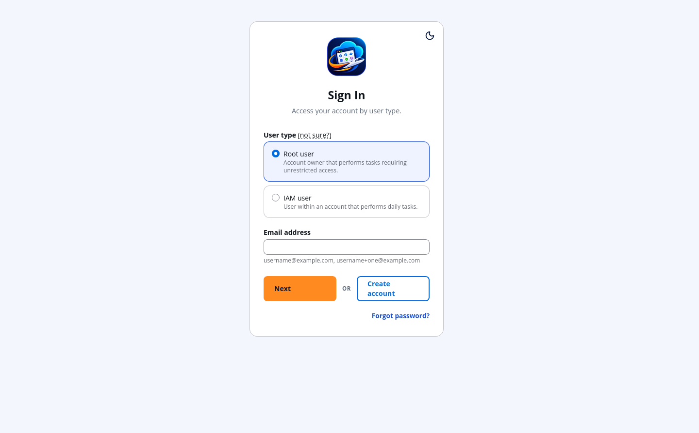
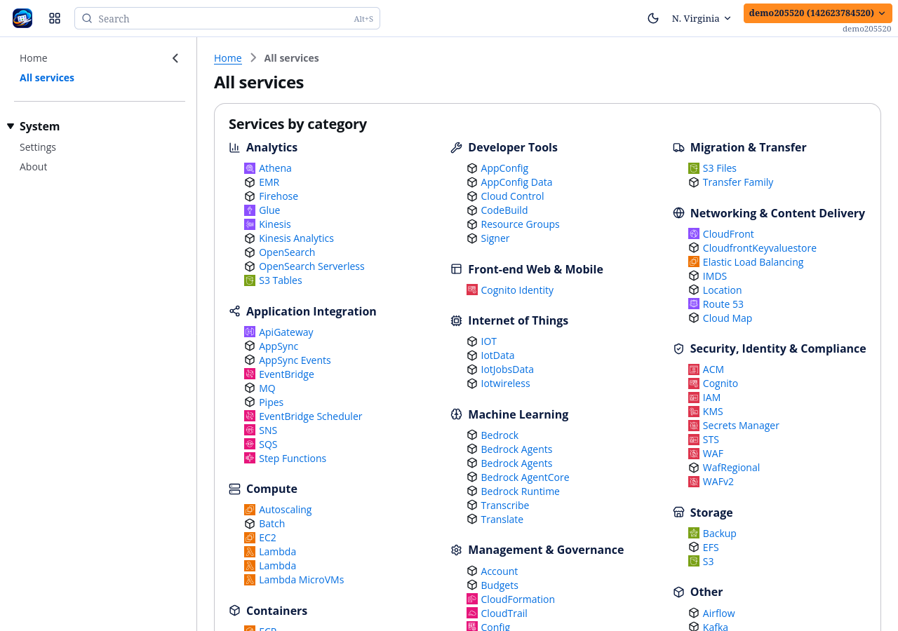

<h1 align="center">
  
  Emuplane
</h1>
<p align="center"><strong>The control plane, console and gateway for AWS-compatible emulators.</strong></p>

<p align="center">
  <a href="https://mathewmusango.github.io/emuplane/"></a>
  
  
  <a href="https://github.com/mathewmusango/emuplane/pkgs/container/emuplane"></a>
  <a href="https://securityscorecards.dev/viewer/?uri=github.com/mathewmusango/emuplane"></a>
</p>

<p align="center">
  <a href="https://github.com/mathewmusango/emuplane/actions/workflows/checks.yml"></a>
  <a href="https://github.com/mathewmusango/emuplane/actions/workflows/tests.yml"></a>
  <a href="https://github.com/mathewmusango/emuplane/actions/workflows/docs.yml"></a>
  <a href="https://github.com/mathewmusango/emuplane/actions/workflows/security.yml"></a>
  <a href="https://github.com/mathewmusango/emuplane/actions/workflows/codeql.yml"></a>
  <a href="https://github.com/mathewmusango/emuplane/actions/workflows/semgrep.yml"></a>
  <a href="https://github.com/mathewmusango/emuplane/actions/workflows/trivy.yml"></a>
  <a href="https://github.com/mathewmusango/emuplane/actions/workflows/scorecard.yml"></a>
  <a href="https://github.com/mathewmusango/emuplane/actions/workflows/dependabot/dependabot-updates"></a>
</p>

---

Emuplane is not an emulator, and not a replacement for AWS. It is what you put in
front of an emulator like [MiniStack](https://github.com/ministackorg/ministack).

The console and the control API are the front door; accounts, logins and access
keys live in the emulator's DynamoDB, never on the host.

> [!NOTE]
> MiniStack is the only emulator this is tested against. Another one that speaks the
> same protocol points at the same `EP_BACKEND_URL`, but nothing else is verified.

```bash
cp .env.example .env    # EP_BACKEND_URL: the emulator as the container sees it
podman-compose up -d    # or: docker compose up -d
```

The container must reach that address: an emulator container on a shared network
(`http://ministack:4566`), or one on the host listening beyond loopback
(`http://host.containers.internal:4566` on Podman, `http://host.docker.internal:4566`
on Docker Desktop).

The image is `ghcr.io/mathewmusango/emuplane`, published per release:
`docker pull ghcr.io/mathewmusango/emuplane:latest` fetches the newest, and the
compose file names the pinned tag it runs.

Or bring the emulator along: `docker-compose.all.yml` with
`.env.all.example` runs MiniStack (`ministackorg/ministack:1.5.40-full`), the
first-setup job and the control as one stack.

`bootstrap` runs first and applies the CloudFormation stack that owns the control's
DynamoDB tables; the console then answers on `http://localhost:4570`.

More: [Quickstart](https://mathewmusango.github.io/emuplane/docs/getting-started/quickstart)
— the emulator first, then the first account and the first bucket.

Nothing is seeded: create the first account at `/signup`.

## The console

Sign in, then every service this instance backs is one page away.

<p align="center">
  
  
</p>

## Accessing it

| What | On the host | In the compose network | Behind a proxy |
| --- | --- | --- | --- |
| Console and control API | `http://localhost:4570/` | `http://emuplane:4570` | `EP_CONSOLE_URL` |
| AWS gateway | `http://localhost:4571` | `http://emuplane:4571` | `EP_GATEWAY_URL` |

```bash
export AWS_ENDPOINT_URL=http://localhost:4571
export AWS_ACCESS_KEY_ID=<the key id from the console>
export AWS_SECRET_ACCESS_KEY=<the secret, shown once>
aws s3 ls
```

The host ports bind `127.0.0.1` and the backend is never published — a client wants
the gateway, never the emulator. An issued `AKIA…` key is verified; the 12-digit
account id is that account's root and is accepted with any secret.

More: [Accessing it](https://mathewmusango.github.io/emuplane/docs/getting-started/access)
— the per-command form, the region rule, and the two kinds of key.

## Documentation

| Page | What it covers |
| --- | --- |
| [Quickstart](https://mathewmusango.github.io/emuplane/docs/getting-started/quickstart) | two containers, one sign-in, one bucket |
| [The console](https://mathewmusango.github.io/emuplane/docs/getting-started/console) | the frame, the service pages, and what each one can read |
| [Access keys](https://mathewmusango.github.io/emuplane/docs/getting-started/access-keys) | minting a key and using it from the CLI |
| [Architecture](https://mathewmusango.github.io/emuplane/docs/concepts/architecture) | the gateway, the control plane and the emulator |
| [S3](https://mathewmusango.github.io/emuplane/docs/guides/s3) | the console's S3 pages |
| [Control API](https://mathewmusango.github.io/emuplane/docs/reference/control-api) | every console route |
| [Configuration](https://mathewmusango.github.io/emuplane/docs/reference/configuration) | every `EP_` setting |
| [Contributing](https://mathewmusango.github.io/emuplane/contributing/) | how to report a bug or an idea, and what a pull request has to clear |

## Layout

| Path | What it is |
| --- | --- |
| [`control/`](control) | gateway, console pages, control API |
| [`web/`](web) | the React + Cloudscape console (its own README) |
| [`site/`](site) | the documentation site |
| [`bootstrap/`](bootstrap) | the CloudFormation template and init job for the control's tables |
| [`scripts/`](scripts) | the QA gate and the maintainer's helpers |
| [`docker-compose.yml`](docker-compose.yml), [`docker-compose.all.yml`](docker-compose.all.yml) | the container contract and the all-in-one stack |

## References

- [Issues](https://github.com/mathewmusango/emuplane/issues) — a bug or an idea
- [Discussions](https://github.com/mathewmusango/emuplane/discussions) — a question about how a rule is meant to behave
- [MiniStack documentation](https://ministack.org/docs/)
- [MiniStack on GitHub](https://github.com/ministackorg/ministack)
- [StackPort (UI inspiration)](https://github.com/DaviReisVieira/stackport)
