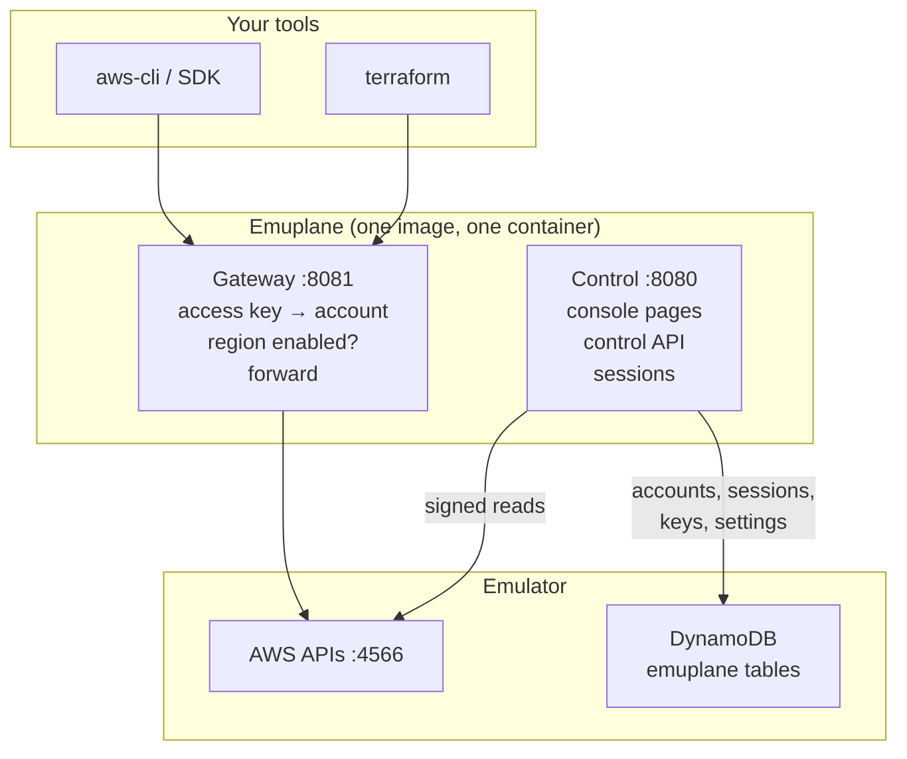
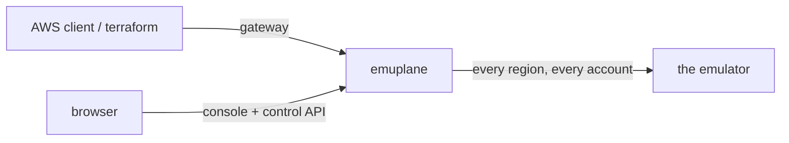

Three processes matter, and only two of them are Emuplane's: your tools, the
gateway, and the emulator — with the console and control plane sitting on top of
the emulator rather than in the request path.

## The gateway owns one rule per request

1. **Which account?** The access key in the SigV4 header names one account; a key
   that names none is refused.
2. **Is its region enabled?** A signing region the account has not enabled is
   `403 AccessDenied` at the gateway, before the emulator is asked. This is what
   stops a bucket from appearing in a region the account never turned on.
3. **Forward.** Everything else the emulator decides.

The gateway checks the *shape* of the request, not the secret behind it: a local
emulator has no secret to check against, and the console's own calls are signed
the same way. Treat the gateway as a router with an authorisation rule, not as an
authenticator.

## The control plane owns the rest

Logins and credentials are Emuplane state: accounts, their users, their sessions,
their access keys (a row on each user), region enablement, both registries and the
console's settings. All of it lives in the emulator's DynamoDB, one table per
store, prefixed `emuplane-`:

| Table | Holds |
| --- | --- |
| `emuplane-accounts` | accounts, their enabled regions, their root and IAM users |
| `emuplane-users` | the users of every account |
| `emuplane-sessions` | live sessions, keyed by a hash of the token |
| `emuplane-resets` | single-use password-reset links |
| `emuplane-owners` | which account claimed which resource name |
| `emuplane-settings` | deployment settings and the bearer token hash |
| `emuplane-buckets`, `emuplane-bucket_nodes` | the console's bucket and node registry |
| `emuplane-cells`, `emuplane-principals`, `emuplane-audit` | the substrate records |

There is no database container, no data volume and nothing on the host: the
console is stateless, so replacing the container costs nothing.

The tables are created by the `emuplane` CloudFormation stack, applied on the
first deployment by the `bootstrap` init job. The control refuses to start on a
missing table rather than serving and failing later, which is why `bootstrap` runs
first and why its failure is fatal.

## Why the console reads rather than trusts

The console asks the emulator for the resource it is about to show — an access
point's report, an object's own tags — rather than rendering a listing twice and
hoping. Two consequences follow, and both are deliberate:

- A read that fails is an **error**, never an empty table.
- A control the backend cannot carry is **absent**, never disabled-looking.

## Where the request path ends

Nothing in Emuplane talks to real AWS. There is no egress rule, no credential
store and no forwarding to a public endpoint; the only outbound call the code
makes is the optional password-reset mail.

## Topology

**There is exactly one emulator, and that is the whole point.** The emulator is a
single process in which each request carries a region (from the SigV4 credential
scope) and an account (from the access key), with state partitioned by both.
Regions and accounts are *configuration*, not containers: adding a region or a
second account is a console action plus a client credential.

| What | Where it comes from | Configured by |
| --- | --- | --- |
| Region | the SigV4 scope (`.../us-west-1/s3/aws4_request`), else the backend's own region setting | the per-account opt-in, from the supported set |
| Account | the access key, else the backend's own account setting | the control's account store |
| State | partitioned per account; per region for S3 on the reference fork | the emulator image |

The emulator is never published on the host: the control reaches it at
`EP_BACKEND_URL`, which on a shared compose network is the emulator's service name.

## What the gateway adds

Beyond the region rule, the control keeps **one account-wide bucket-name
registry**, keyed by name, so a name cannot exist in two accounts or two regions —
AWS keeps S3 names unique partition-wide.

- `CreateBucket` is **reserved atomically** and recorded against the requesting
  account; a second claim gets `409 BucketAlreadyExists`, whichever account or
  region asks. The one exception is the owner re-creating a bucket in its own
  region: that request is forwarded so the emulator answers AWS's `200` or
  `BucketAlreadyOwnedByYou`.
- `DeleteBucket` on success releases the name.
- The registry is rebuilt from the emulator's `ListBuckets` at startup, on
  `POST /api/refresh`, and by the poller. An inventory that cannot be read is kept
  and marked stale rather than dropped.

If the emulator is down the gateway answers `503 ServiceUnavailable` instead of
hanging. A region the instance advertises is enabled on first use and recorded
against the account; a region it does not advertise is always refused.
