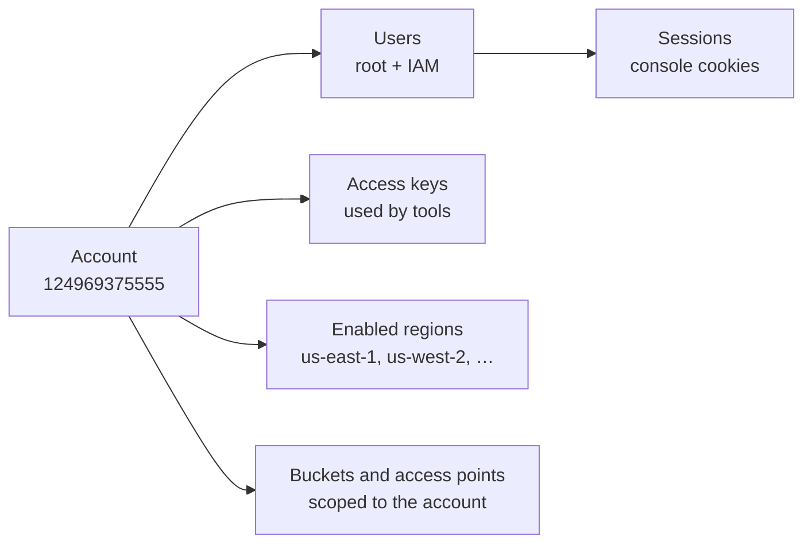

An **account** in Emuplane is a tenancy: it owns its users, its buckets, its
access keys and its list of enabled regions. Nothing crosses it except the
deployment's bearer token.

## Accounts

- A 12-digit id, a name, and a root user created at sign-up.
- IAM users belong to one account and can be given their own password.

### Root owns the account; IAM users join it

- The **root user is the account**. Sign-up asks for an email address, an
  account name and a password, and creates both in one step: the account is
  named by you, and its root principal is `root`, identified by that email.
- Root has **full access to its own account and to nothing else**. It is not a
  global root, and it cannot read or change another account's state.
- **IAM users join** the account. You add them inside it, and their names are
  unique **within that account**, so two accounts may each have an `alice`.
- A user name therefore only has to be understood in its account: the console
  shows the account name beside the account id and the user name as the identity
  inside it, because they live at different levels.
- An **email address belongs to one principal only**, deployment-wide. That is what
  makes a password reset unambiguous: `/forgot` finds one account, not the first
  row that matches. A store written before the rule is not guessed at — an address
  two principals share resets neither, and an administrator issues the link.
- Signing in follows the same split: root mode takes the **email**, IAM mode
  takes the **account and the user name**.
- The deployment bearer token is the one principal that may cross tenancies, and
  it exists so an operator can administer the deployment rather than to act as a
  global root.

## Regions

- `us-east-1` is always enabled; it cannot be removed.
- Every other region an account uses has to be **enabled**, either from the
  console or **on first use** — a request signed for a region the account has not
  used yet enables it, exactly as the console's region menu does.
- The gateway enforces this per request, so a bucket cannot be created in a
  region the account never turned on.
- A bucket keeps its own home region. A request signed for a different region
  gets `301 PermanentRedirect` with `x-amz-bucket-region`, and the console reads
  that to send the page to the right place.

## Access keys

Access keys are what your tools use. They are minted per account in the console,
shown **once**, and the secret is not readable afterwards.

The gateway resolves the key to its account and checks the request's signing
region. It does **not** verify the signature: a local emulator has no secret to
verify against, so the gateway is a router with an authorisation rule, not an
authenticator. Do not put anything in front of it that you would not put on a
lab network.

## Sessions

- A console session is a cookie; the server keeps it keyed by a hash of the
  token, so a stolen cookie store does not hand anyone a working session.
- Resetting a password revokes that user's sessions.
- `/forgot` issues a single-use link. With no mail transport configured — the
  default — it says to ask an administrator, and `./scripts/password.sh` does the
  reset.

## What a token is, and is not

| Credential | Used by | Scope |
| --- | --- | --- |
| Console session | a person in the browser | one account, until it expires or is revoked |
| Access key | aws-cli, terraform, SDKs | one account, through the gateway |
| Bearer token | the deployment / operators | every account — the only cross-tenant principal |
