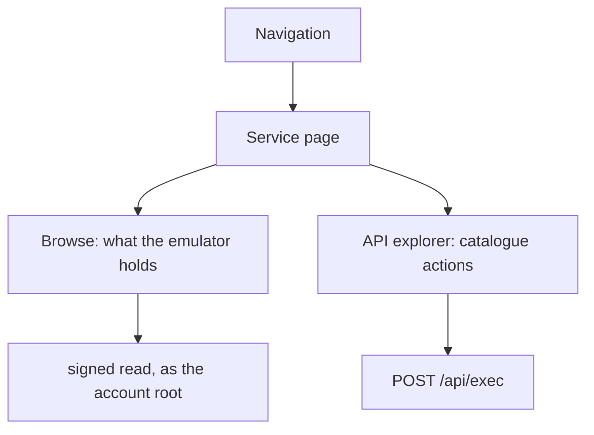

The console is the reason Emuplane exists: every claim it makes is backed by a
read the console can actually perform. A page that cannot read something says so
instead of showing an empty table.

## The frame

- **Region menu** (top bar) — sets the region every page acts in, and follows
  into the URL, so a page you can see is a page you can bookmark.
- **Navigation** — services down the side; S3 is the one with purpose-built
  pages, the rest go to a generic service page.
- **Account menu** — the signed-in account, its access keys, its regions, and
  the sign-in screens.

Signing out is a real session revocation, and a wrong password is answered as a
wrong password rather than as "your session expired".

## Services without a purpose-built page

Every service the emulator advertises is browsable: the console reads what the
emulator holds and groups it by kind (IAM users/roles/groups/policies, EC2
instances/security groups/key pairs, and so on), one tab per kind.

Eleven services also ship **actions** — `s3`, `ec2`, `sqs`, `sns`, `dynamodb`,
`iam`, `logs`, `secretsmanager`, `ssm`, `kinesis`, `stepfunctions`. The API
explorer drives those through one control route (`/api/exec`), with the AWS call
each action maps to shown before you press it.

## S3

Two pages carry the console's own shape rather than the emulator's:

| Page | What it is |
| --- | --- |
| **Buckets** | Every bucket across the account's enabled regions, each row carrying its own region. |
| **Bucket** | The console's tabs: Objects, Properties, Permissions, Management, File systems, Access Points. |
| **Object** | Content, Tags, Annotations, Object Lock — each read on its own. |
| **Access Points** | General purpose, Multi-Region and Object Lambda, each tab read from the region (or the one region) that serves it. |

[S3](/docs/guides/s3) covers what each of those does; [S3 coverage](/docs/reference/s3-coverage)
records which operations are reachable and which are not.

## Where the console is deliberately plain

A page never invents a control the backend cannot carry. Directory buckets,
Storage Lens and S3 Metrics are absent rather than empty; Object Lambda access
points are listed but not created; a failed read is an error alert, not a
zero-row table.
