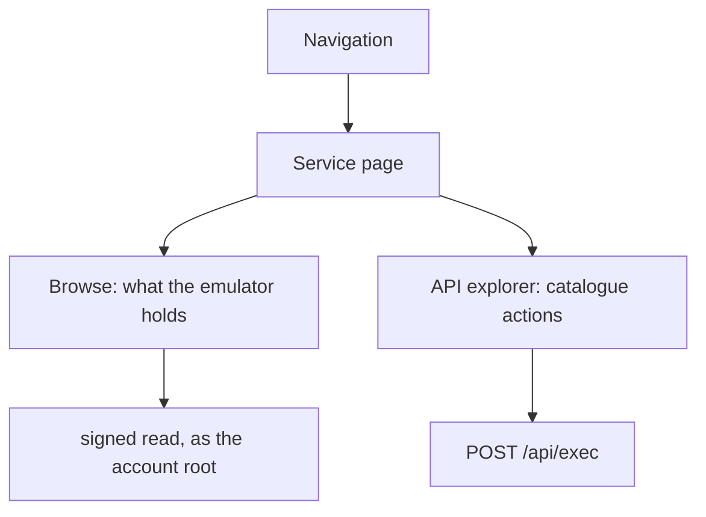

The console is the reason Emuplane exists: every claim it makes is backed by a
read the console can actually perform. A page that cannot read something says so
instead of showing an empty table.

<figure>
  <figcaption>Console Home is a grid of widgets, every one of them a read: the
  services this account has opened, the account's resource counts, and the
  addresses to point a CLI at. The instance's own readings — versions, backend,
  emulator reachability and uptime — live on <b>About</b>, not here.</figcaption>
</figure>

## The frame

- **Region menu** (top bar) — sets the region every page acts in, and follows
  into the URL, so a page you can see is a page you can bookmark.
- **Navigation** — services down the side, and only those with a page behind them:
  S3 and its sub-pages, IAM's own console section, and the twelve services that
  carry actions. A name with nothing behind it is not offered.
- **Account menu** — the signed-in account, its access keys, its regions, and
  the sign-in screens.

Signing out is a real session revocation, and a wrong password is answered as a
wrong password rather than as "your session expired".

## The menu is a short list, not an inventory

The emulator answers far more services than the menu shows, and that is deliberate.
An entry is a promise that something is behind it, so two things earn one: an
**official mark**, and a **page** — either the generic service page, with its resource
list and API-explorer actions, or purpose-built pages of its own. A name that opens a
page which redirects straight back to All services is worse than no name at all, so
the services Emuplane has not built for are reachable over the wire only. The
[coverage pages](/docs/reference/) record what each of them answers.

That leaves fourteen entries. Twelve ship **actions** — `s3`, `ec2`, `sqs`, `sns`,
`dynamodb`, `iam`, `lambda`, `logs`, `secretsmanager`, `ssm`, `kinesis`,
`stepfunctions` — and each of those also has a resource list the console can read:
buckets, instances, queues, functions, users, log groups, and so on, one *kind* per
row. S3 Tables and S3 Files are children of S3 with pages of their own. The API
explorer drives an action through one control route (`/api/exec`), with the AWS call
it maps to shown before you press it.

<figure>
  <figcaption>Fourteen entries, grouped by kind. Each one has an official mark and a
  page behind it; a service the emulator answers but Emuplane has not built for is
  not offered here.</figcaption>
</figure>

<figure>
  <figcaption>One generic service page: what the emulator holds on top, the
  catalogue of actions underneath, each showing the `aws` command it maps
  to.</figcaption>
</figure>

## Account and About

**Account** and **About** sit under every service list, on every page. Account is the
account itself — its name and ARN, the emulator's contact block, and the regions it
answers — read from the account API rather than from Emuplane's own records. Access
keys have their own page, **Security credentials**, in the account menu.

**About** is the instance's own page: the Emuplane and backend versions, the API
version, whether the emulator answers and which version it reports, how many services
are answering, how long the control plane has been up, and the addresses it serves.
Home deliberately carries none of that — it is about the account's work, not about
the process serving it.

<figure>
  <figcaption>Billing and Cost Management › Account: four account operations, shown
  as they answer. The account name and contact details are the emulator's, and
  read-only.</figcaption>
</figure>

## S3

Two pages carry the console's own shape rather than the emulator's:

| Page | What it is |
| --- | --- |
| **Buckets** | Every bucket across the account's enabled regions, each row carrying its own region. |
| **Bucket** | The console's tabs: Objects, Properties, Permissions, Management, File systems, Access Points. |
| **Object** | Content, Tags, Annotations, Object Lock — each read on its own. |
| **Access Points** | General purpose, Multi-Region and Object Lambda, each tab read from the region (or the one region) that serves it. |

[S3](/docs/guides/s3) covers what each of those does, with a screenshot of every
tab; [S3 coverage](/docs/reference/s3-coverage) records which operations are
reachable and which are not.

## IAM

IAM is the second purpose-built section. Its sidebar is the AWS one: a dashboard,
the four identity lists, account settings, the credential report and the API
explorer for everything the pages do not draw.

| Page | What it is |
| --- | --- |
| **IAM users** | Every IAM user the emulator holds, with groups, MFA and whether it can sign in to this console; create, delete and set a password. |
| **Roles** | Each role's trusted entity and path, with create and delete. |
| **Policies** | AWS-managed and customer-managed policies, attachment counts and descriptions. |
| **Groups / Identity providers** | Members and attached policies; OIDC and SAML providers by type. |
| **Account settings** | The emulator's password policy and its account alias (the sign-in URL carries it). |
| **Credential report** | Generated and downloaded as the CSV the emulator answers. |

[IAM coverage](/docs/reference/iam-coverage) records every advertised operation,
which of them the console reaches, and the test that exercises it.

## Where the console is deliberately plain

A page never invents a control the backend cannot carry. Directory buckets,
Storage Lens and S3 Metrics are absent rather than empty; Object Lambda access
points are listed but not created; a failed read is an error alert, not a
zero-row table.
