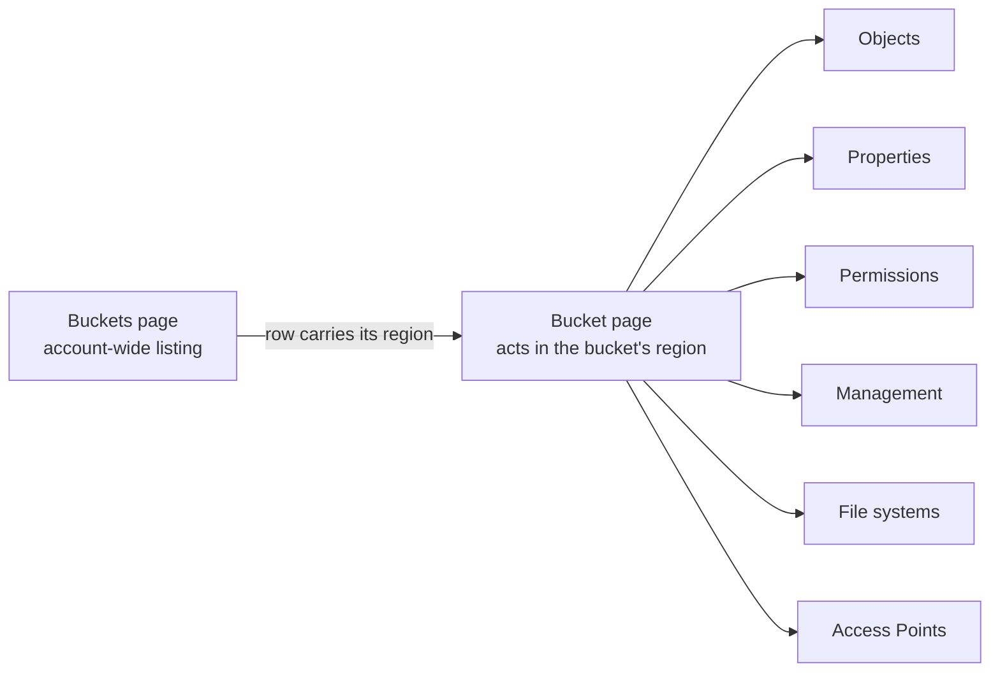
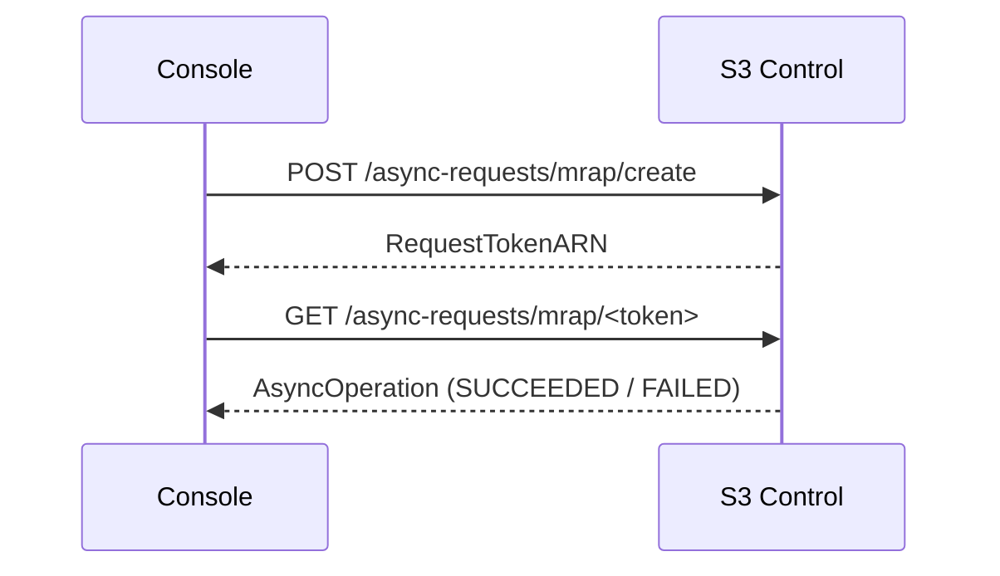

S3 is the service Emuplane has purpose-built pages for. Everything below is
available in the console, and nothing below is claimed unless a read backs it.

## The rule that shapes the pages

A bucket lives in one region; a listing is account-wide. The console shows both
truths: the **Buckets** page lists every bucket in the account with its own
region in the row, and every page you open afterwards acts in the region the
bucket actually lives in — never the region the menu happens to show.

## The bucket page

| Tab | What it reads | What it can write |
| --- | --- | --- |
| **Objects** | `ListObjectsV2` for the bucket, in its region | upload (typed or a file), copy, delete, empty |
| **Properties** | versioning, default encryption, tags | versioning, encryption (SSE-S3/KMS, bucket key), tags |
| **Permissions** | Block Public Access; the ACL where the bucket allows ACLs | Block Public Access; ACL as a document |
| **Management** | the configuration documents: lifecycle, CORS, policy, logging, notifications, replication | each document, through its own editor; delete where S3 has a delete |
| **File systems** | the S3 Files API | — |
| **Access Points** | the access points attached to this bucket | — |

Configuration documents are shown as the document S3 answers with, not as a
flattened form: a lifecycle rule or a Lambda notification has structure that a
form would lose. An **ACL is refused where the bucket disables ACLs**
(`BucketOwnerEnforced`), with S3's own sentence, instead of offering an edit that
cannot work.

## The object view

An object opens with what only an object can answer:

| Tab | The read behind it |
| --- | --- |
| **Content** | `GetObject` — text is shown, anything else is offered as a download |
| **Tags** | `GetObjectTagging` |
| **Annotations** | `ListObjectAnnotations`, then one annotation's own body |
| **Object Lock** | retention and legal hold, on a version of the object |

A failed read in any of those is an error alert. It is never an empty list.

## Access points

Access points are S3 Control, not bucket subresources, and the page keeps that
split: each tab is read from the region that serves it.

| Tab | Listed | Created here |
| --- | --- | --- |
| **General purpose buckets** | in the page's region | yes — name, bucket, network origin/VPC, Block Public Access, policy |
| **Multi-Region** | from us-west-2, where S3 Control manages them | yes — see below |
| **Object Lambda** | in the page's region | no — listed, with configuration and policy read in full |

### Multi-Region access points are asynchronous

Creating, deleting or re-policy-ing a Multi-Region access point is an
**asynchronous request**: S3 Control answers with a request token and applies the
change later. The console shows the operation the token names — status, the
per-region results, and the error code if it failed — because the token exists
only in that answer.

Two rules the page enforces before asking:

- **Members come from different regions.** Two buckets in one region is the
  request S3 refuses (`MultiRegionAccessPointSameBucketRegion`).
- **One member stays active.** A traffic dial is `0` or `100`, and every member
  at `0` is refused.

A Multi-Region access point's policy is **replaced, never removed**: S3 Control
has no delete for it, so the editor offers no "remove" it could not honour.
