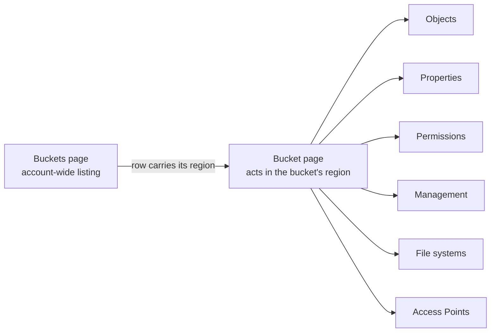
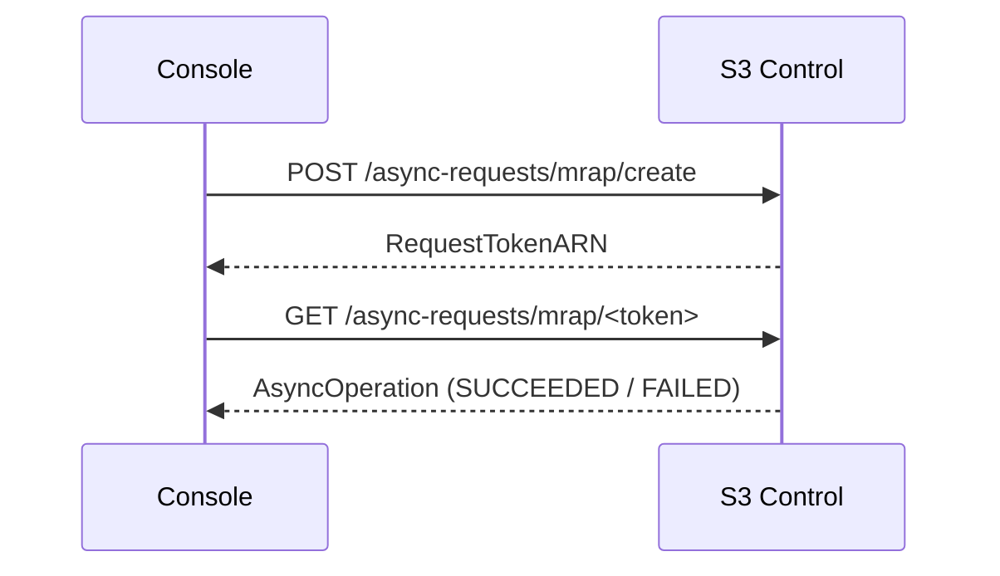

S3 is the service Emuplane has purpose-built pages for. Everything below is
available in the console, and nothing below is claimed unless a read backs it.

## The rule that shapes the pages

A bucket lives in one region; a listing is account-wide. The console shows both
truths: the **Buckets** page lists every bucket in the account with its own
region in the row, and every page you open afterwards acts in the region the
bucket actually lives in — never the region the menu happens to show.

## The bucket page

| Tab | What it reads | What it can write |
| --- | --- | --- |
| **Objects** | `ListObjectsV2` for the folder, plus the folder's incomplete multipart uploads (`ListMultipartUploads`, `ListParts`) | upload (typed or a file), copy, move, delete, empty, storage class, per-object encryption, object ACL, abort an incomplete upload |
| **Properties** | versioning, the version listing (`ListObjectVersions`), default encryption, tags, and the website/logging/notification documents | versioning, encryption (SSE-S3/KMS, bucket key), tags, a single version, each document |
| **Permissions** | Object Ownership, Block Public Access; the ACL where the bucket allows ACLs | Object Ownership, Block Public Access, ACL as a document |
| **Management** | the configuration documents: lifecycle, CORS, policy, logging, notifications, replication | each document, through its own editor; delete where S3 has a delete |
| **File systems** | the S3 Files API ([coverage](../reference/s3-files-coverage.md)) | — |
| **Access Points** | the access points attached to this bucket | — |

Configuration documents are shown as the document S3 answers with, not as a
flattened form: a lifecycle rule or a Lambda notification has structure that a
form would lose. An **ACL is refused where the bucket disables ACLs**
(`BucketOwnerEnforced`), with S3's own sentence, instead of offering an edit that
cannot work.

The object ACL dialog opens on the ACL as S3 holds it (`GetObjectAcl`: owner,
every grant, and whether a grant names the `AllUsers` group), and stays open after
a write so the grant can be read back rather than assumed. The same refusal
sentence appears there when the bucket disables ACLs.

**An ACL belongs to a version.** Where the key has older versions, the dialog
offers them in a Version menu and reads and writes the one chosen
(`?acl&versionId=…`); *Current version* is the one the key resolves to. The
grants on two versions of one key are independent.

**Object Ownership is a switch, not a statement.** The Permissions tab reads
`GetBucketOwnershipControls` and can change it (`PutBucketOwnershipControls`):
*bucket owner enforced* turns ACLs off and *bucket owner preferred* turns them on
for the ACL dialog. The objects do not move; grants stop applying while ACLs are
off, and turning them back on does not restore grants that were ignored.

Versioning is shown the way S3 answers it — **Disabled**, **Enabled** or
**Suspended** — because an enabled bucket is never disabled again, only suspended.
The bucket's **creation date** comes from `ListBuckets`, the only read that carries
it.

**Versions are a listing, not the raw XML.** `ListObjectVersions` answers with one
row per version of every key under the folder, at any depth — key, version ID,
whether it is the latest, whether it is a delete marker, size, last modified and
storage class. A version can be downloaded on its
own (`GetObject` with `versionId`), and deleted on its own (`DeleteObject` with
`versionId`), which removes that version and leaves the rest of the key alone.
Removing a delete marker puts the version beneath it back as the current one; the
confirmation says so before the delete. An empty listing distinguishes the two
cases that look alike: a bucket that has never versioned, and a folder with no
versions yet. A listing is one page of up to 1000 versions, so a long one
continues with **Load more versions** on the listing's own
`NextKeyMarker`/`NextVersionIdMarker` rather than stopping silently.

Every object written before versioning was enabled answers the version id
`null`: it is one version, and S3 names it that way. A long id is elided in the
cell and given in full on hover, in the download URL and in both action labels.

**Incomplete uploads are shown, and can be aborted.** `ListMultipartUploads`
names the uploads that were started in this folder and never completed, and
`ListParts` shows what each one holds. Aborting (`AbortMultipartUpload`) discards
every part S3 keeps for it. Completing an upload that another client started is
not offered here — the client that opened it holds the part list it will send.
Both listings are pages too: **Load more uploads** follows
`NextKeyMarker`/`NextUploadIdMarker`, and **Load more parts** follows
`NextPartNumberMarker`.

**MFA delete is built but not surfaced.** MiniStack accepts `MfaDelete` on
`PutBucketVersioning` and never returns it, so Emuplane keeps the flag on the
bucket's claim and the **gateway** enforces it: an API client that deletes an
object version, or changes versioning, without an `x-amz-mfa` header is refused,
and a bucket under the flag cannot be deleted. It also enables versioning with it,
because MFA delete only exists on a versioned bucket. None of that is on the
console yet — the Properties tab shows versioning without an MFA delete row, and
the create page does not offer it. It returns as a control when it is wanted again;
until then the [Limits](../reference/limits.md#mfa-delete) page carries the
caveats.

**Bucket ABAC is absent, not explained.** The endpoint evaluates
`aws:ResourceTag/…` conditions against a bucket's own tags but answers no ABAC
status, so there is nothing to read and nothing to switch; the Properties tab draws
no panel. It becomes a switch when the endpoint answers `GetBucketAbac`. That is on
the [Limits](../reference/limits.md) page.

Two limits, stated plainly: the header's *code* is not checked, because no MFA
device is enrolled in this control plane, and the guard lives in the gateway, so a
client that reaches the emulator directly bypasses it. Both — and the rest of what
this console does not do — are on the [Limits](../reference/limits.md) page.

### Creating a bucket

A new bucket is one page rather than a wizard: the namespace (global, or the
account's own regional suffix so the name cannot collide), the name, then the
settings the bucket is born with — Object Ownership, Block Public Access,
versioning, tags, encryption and Object Lock. **Copy settings from an existing
bucket** carries those over from a bucket you already have; Object Lock is the one
setting it cannot copy once the new bucket has it, because S3 never turns it off.

### Folders

A folder is a prefix, and the console shows one level of it at a time
(`delimiter=/`): a row that ends in `/` opens that prefix, and the breadcrumb is
the way back up — every step of the path is a link. The page's address carries
the prefix, so a new tab or the back button lands in the same folder.

A listing is one `ListObjectsV2` page, which S3 caps at 1000 keys. A folder with
more than that offers **Load more objects**, which continues with the listing's
own continuation token instead of reading the folder again.

## The object view

An object opens with what only an object can answer:

| Tab | The read behind it |
| --- | --- |
| **Content** | `GetObject` — text is shown, anything else is offered as a download |
| **Tags** | `GetObjectTagging` |
| **Annotations** | `ListObjectAnnotations`, then one annotation's own body |
| **Object Lock** | retention and legal hold, on a version of the object |

A failed read in any of those is an error alert. It is never an empty list.

## Access points

Access points are S3 Control, not bucket subresources, and the page keeps that
split: each tab is read from the region that serves it.

| Tab | Listed | Created here |
| --- | --- | --- |
| **General purpose buckets** | in the page's region | yes — name, bucket, network origin/VPC, Block Public Access, policy |
| **Multi-Region** | from us-west-2, where S3 Control manages them | yes — see below |
| **Object Lambda** | in the page's region | no — listed, with configuration and policy read in full |

### Multi-Region access points are asynchronous

Creating, deleting or re-policy-ing a Multi-Region access point is an
**asynchronous request**: S3 Control answers with a request token and applies the
change later. The console shows the operation the token names — status, the
per-region results, and the error code if it failed — because the token exists
only in that answer.

Two rules the page enforces before asking:

- **Members come from different regions.** Two buckets in one region is the
  request S3 refuses (`MultiRegionAccessPointSameBucketRegion`).
- **One member stays active.** A traffic dial is `0` or `100`, and every member
  at `0` is refused.

A Multi-Region access point's policy is **replaced, never removed**: S3 Control
has no delete for it, so the editor offers no "remove" it could not honour.
