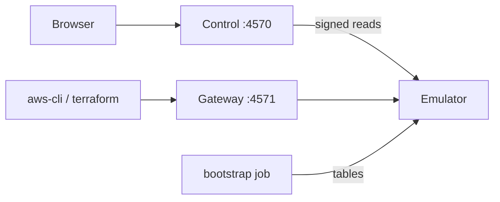

Every entry below is a symptom you can actually see, then the one thing that
causes it. The order follows the path a deployment takes: the console, the
container behind it, sign-in, the CLI, then the emulator. Where a message is
quoted from the code, the wording is the code's — search for it here rather than
reading the source.

## The console

**About says the backend is `unreachable`.** The control is up and cannot reach
the emulator. The row carries the error; the usual cause is
`EP_BACKEND_URL` naming `localhost`, which inside a container is the container
itself. Name the emulator the way *the control* sees it — the service name on a
shared network, or `host.containers.internal` / `host.docker.internal` for one on
the host. Then note what the health check does not tell you: `/health` is
liveness only and answers `200` while the emulator is down, and the compose
healthcheck calls exactly that. **A healthy container is not a working console** —
the row on **About** and a read are the real checks. See
[Deployment](../deployment/index.md) and
[Configuration](../reference/configuration.md).

**The page says "Console not built".** You are running the control from a
source checkout in which `web/dist` does not exist. The control serves the API
and the server-rendered pages regardless, so this is a build gap, not a failure:
`npm install && npm run build` in `web/`, then restart the container.

**The container starts and immediately stops.** Look at `bootstrap`, not at
`emuplane`: the control is ordered after the first-setup job with
`depends_on: … service_completed_successfully`, so a failed job means the control
never starts. `docker compose logs bootstrap` names the reason, and each message
has exactly one cause:

| Message | What it means |
| --- | --- |
| `cannot reach the emulator at <url>` | `EP_BACKEND_URL` is wrong for the container, or the emulator is not up yet |
| `stack emuplane is ROLLBACK_COMPLETE; delete it and re-run` | the stack was left in a failed state; `docker compose run --rm bootstrap python /app/bootstrap/apply.py --delete`, then `up -d` |
| `N table(s) already exist without a stack owning them` | the tables predate the stack — CloudFormation will not adopt them. The control runs against them anyway; adopting them means dropping them, which loses the accounts |
| `the stack is up but these tables are missing: …` | the template and the emulator disagreed; the stack is there, so read its events |

**`address already in use` on `4570` or `4571`.** Something else holds the port,
usually a previous stack. The ports are fixed — the container listens on them and
publishes the same numbers — so this is not solvable with a setting. Stop the
other stack (`docker compose down` in its directory) and bring this one up.

## Sign-in

**"An account with that name already exists. Choose another account name."**
Nothing is seeded on purpose, but the store is not in the container: accounts
live in the emulator's DynamoDB, so replacing or recreating the control costs
nothing and the account is still there. Either sign in instead of signing up, or
start the store over — which
is `docker compose run --rm bootstrap python /app/bootstrap/apply.py --drop-tables`,
and it deletes **every** account, user, session, key and setting. See
[Architecture](../concepts/architecture.md#the-control-plane-owns-the-rest).

**"That email address already belongs to a principal. One address, one
sign-in."** Addresses are unique across the whole store, not per account.

**"That reset link has expired or was already used."** Links are single-use and
live for `EP_RESET_SECONDS` (default 1800). Request another.

**`/forgot` offers you a link instead of mailing one.** `EP_MAIL_HOST` is empty,
so mail is off by design and the reset becomes an administrator-issued link. Set
the relay on the [Configuration](../reference/configuration.md) page to turn
mail on.

**The sign-in screen rejects an MFA code.** MFA enrolment is not implemented:
`POST /api/auth/mfa` answers `501`, and signing in a principal that already has
MFA enabled is refused. See [Limits](../reference/limits.md#sign-in).

**A session ends sooner than you expect.** `EP_SESSION_SECONDS` defaults to 28800
and is extended on activity. A wrong password is answered as a wrong password
rather than as an expired session, so the two messages mean different things.

## The CLI

Most of these are answers from the **gateway**, before the emulator is consulted
— the entries that are not say so. Check `AWS_ENDPOINT_URL` first: it must be the
gateway (`:4571`), not the console and not the emulator. When the answer is still
not obvious, the console's
[Request inspector](../getting-started/console.md#request-inspector) (`/traffic`)
lists what the gateway saw — the resolved operation, status and duration — for the
account that signed in.

**`403 AccessDenied` — "region `eu-west-1` is not enabled for this account".**
The gateway refuses a signing region the account has not enabled, before the
emulator sees the request. `us-east-1` is always enabled; any other region
becomes enabled the first time the console acts in it, so pick it in the region
menu once and the CLI can sign for it afterwards. See
[Architecture](../concepts/architecture.md#the-gateway-owns-one-rule-per-request).

**`403 AccessDenied` — "no access key to list buckets for".** `ListBuckets` is
account-scoped, so an anonymous request is refused at the gateway; the emulator's
anonymous gate is bucket-scoped and would have answered with the default
principal's list. Set `AWS_ACCESS_KEY_ID` and `AWS_SECRET_ACCESS_KEY`. See
[Limits](../reference/limits.md#the-gateway).

**`503 ServiceUnavailable` — "no emulator is configured", or "… unreachable".**
The gateway answers `503` instead of hanging when there is nothing to forward to.
This is the same fault as an `unreachable` health widget: fix `EP_BACKEND_URL`.

**`409 BucketAlreadyExists` — "Bucket … already exists".** There is one
account-wide name registry, so a name cannot exist in two accounts or two
regions. It is the same sentence the emulator sends. Delete the bucket in the
account that owns it, or choose another name.

**`301`, or a bucket that is missing from `aws s3 ls`.** Not the gateway: buckets
are region-scoped and `ListBuckets` answers per region, so sign for the bucket's
region. A request signed for another region gets the `301` AWS returns. See
[Addressing](../reference/limits.md#addressing).

**Virtual-hosted-style requests behave oddly.** Use path-style
(`s3_use_path_style = true` in Terraform). Virtual-hosted requests are parsed
best-effort.

**`403 AccessDenied` — "MFA Delete is enabled on this bucket …".** Two distinct
messages, two distinct fixes: a version delete or a versioning change needs an
`x-amz-mfa` header, and a bucket delete is refused outright — turn the flag off
first. The header's *code* is not checked, only its presence. See
[MFA delete](../reference/limits.md#mfa-delete).

## The emulator

**A `200` is not evidence a feature exists.** This is the single most useful
thing on this page: an unknown subresource falls through to the default
operation, so a bucket `GET` answers a plain listing and an object `GET` answers
the object's own bytes, both `200`. Read the document, never the status. Only
`SelectObjectContent` refuses cleanly (`405 MethodNotAllowed`). See
[Limits](../reference/limits.md#the-emulator).

**`413` on an upload.** One request body over 25 MiB is refused; the console's own
uploads go multipart above 8 MiB and stop at 200 MiB per file. For anything
larger, put the object there with a client instead.

**"the configuration is not XML".** The control parses the Object Lambda document
with `defusedxml`, which refuses a `<!DOCTYPE` or an `<!ENTITY` rather than
expanding it. S3 Control's own documents never carry a DTD; drop it.

**The S3 pages look unpolished on Windows.** They are: S3 on Windows is still
under development. That is a report to make, not a behaviour to rely on.

## What to collect before reporting

Four things turn a report into a fix, because each one rules out a layer:

1. The **exact** message, quoted — the gateway's and the bootstrap job's are
   unique sentences, and this page is indexed by them.
2. `docker compose logs bootstrap emuplane` (or `podman-compose logs`).
3. The **Request inspector** row (`/traffic`) for that call: the resolved
   operation, status and duration, which says whether the gateway or the
   emulator answered.
4. What **About** says about the backend (reachable, id) and the version beside it.
5. Whether the same call works **from the console**, which separates a gateway
   fault from an emulator one.

Then open an [issue](https://github.com/mathewmusango/emuplane/issues/new/choose)
with that in it.
