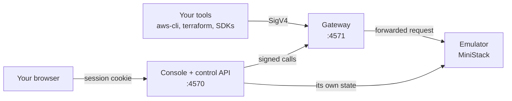

Emuplane is a **console and control plane in front of an AWS emulator**. It gives
you the parts of local AWS that a CLI alone cannot show: accounts you sign in to,
regions an account has enabled, access keys you can hand to a tool, and console
pages where a bucket, an object or an access point is readable rather than
implied.

## What it is

| Piece | What it does |
| --- | --- |
| **Gateway** | The SigV4 front door for your tools. It resolves the account from the access key, refuses a region the account has not enabled, and forwards the request to the emulator. |
| **Control plane** | Accounts, users, sessions, access keys, region enablement, and its own state — kept in the emulator's DynamoDB, so there is no separate database to run. |
| **Console** | A React + Cloudscape UI: a region menu, service pages, the S3 pages, an API explorer and the sign-in screens. |

Nothing is seeded. The first account is made at `/signup`, and the deployment's
bearer token is minted once inside the container (`python /app/api_token.py`).

<figure>
  <figcaption>The console is not a mock-up of AWS: each panel is a call the
  control plane made as the account's root, with what the emulator answered.</figcaption>
</figure>

## What it is not

- **Not an emulator.** The emulator is a separate project; Emuplane talks to it
  through one URL. [MiniStack](https://github.com/ministackorg/ministack) is the
  verified backend in this cycle (1.5.40-full); anything that speaks the same
  protocol points at the same URL.
- **Not a proxy to real AWS.** It is a local lab: no credential leaves the box.
- **Not production infrastructure.** A control plane for a lab, sized to run
  beside the emulator on one host.

## Where to go next

- [Quickstart](/docs/getting-started/quickstart) — two containers, one sign-in,
  one bucket.
- [Architecture](/docs/concepts/architecture) — what runs where, and which
  component owns which rule.
- [Beyond the emulator](concepts/extensions.md) — what Emuplane adds that the
  emulator has no opinion about, MFA delete included.
- [S3](/docs/guides/s3) — the pages, and what each one is allowed to claim.
- [S3 coverage](/docs/reference/s3-coverage) — every operation, and whether the
  console can show or do it.
- [Control API](/docs/reference/control-api) — the routes the console calls, and
  how to call them yourself.
