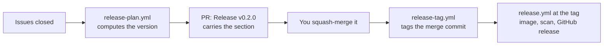

`CHANGELOG.md` is built from **issues**, not from commits. An issue's labels pick
its section, and its title — or a `Changelog:` line in its body — becomes the
bullet. The version is computed from those same labels, so one decision produces
the number and the notes.

## The label decides the section

| Label | Section | Bump |
| --- | --- | --- |
| `added`, `feature`, `enhancement` | Added | minor |
| `changed`, `improvement` | Changed | minor |
| `deprecated` | Deprecated | minor |
| `removed` | Removed | major |
| `fixed`, `bug` | Fixed | patch |
| `security` | Security | patch |

`chore`, `skip-changelog`, `internal`, `question`, `duplicate`, `invalid` and
`wontfix` are left out, and so is an issue closed as **not planned**. The map lives
in [`.github/changelog.json`](https://github.com/mathewmusango/emuplane/blob/main/.github/changelog.json),
which is also what the two CI gates and the label sync read.

## Writing a bullet that reads well

The default bullet is the issue title. When the title is written for the tracker
rather than for a reader, put a line in the issue body:

```
Changelog: The gateway resolves the account from the access key, not from the header order.
```

That line becomes the bullet; the title stays however the tracker wants it.

## Choosing the version

The bump comes from the issue labels, so the version and the changelog have one
source. The highest bump among the release's issues wins and the lower numbers
reset: a feature on `1.4.2` is `1.5.0`, a removal on `1.4.2` is `2.0.0`.

Below `1.0.0` a removal moves the **minor** number instead — `0.1.0` → `0.2.0` —
because SemVer reserves the leading number for the first stable API. This project is
pre-1.0 and says so.

```bash
GITHUB_TOKEN=… python3 scripts/changelog.py --next-version             # what the issues imply
GITHUB_TOKEN=… python3 scripts/changelog.py --next-version --version v0.1.0
```

With no tag and no flag it starts from `0.0.0`, which is what the first release
needs. It prints a number and writes nothing.

**Why not Release Please, semantic-release or git-cliff.** All three derive the
version — and the entries — from commits. Here the unit is the issue, so a commit
prefix would be a second source of truth for one decision: a `fix:` commit closing
a `removed` issue would compute the wrong number. git-cliff answers a different
question ("what changed in the code"); it becomes interesting after Rust lands, for
per-crate notes from conventional commits, not for this changelog.

## `Unreleased`, and the first release

`--write` never invents a section for a version already in the file, and it never
touches `Unreleased`. So the two kinds of entry stay distinct:

- **`Unreleased` is the human scratchpad** — notes that matter before an issue
  exists. It is yours to edit.
- **A released section is generated from that release's issues.** The first release
  is generated too, from the issues written for the initial import.
- **Never both for the same change.** A generated bullet repeating an `Unreleased`
  note is the signal that the note should have become an issue.

The first release measures from the repository's first commit, not from a tag that
does not exist yet, so `--since` is optional there too.

## A release

`main` is protected: nothing is pushed to it directly, it takes squash merges only,
and it keeps a linear history. **No one bypasses it, including the owner** — the
release pull request is merged like any other. So the release is a pull request the
bot opens and a person merges:



1. **`.github/workflows/release-plan.yml`** runs on every push to `main`. It asks
   `scripts/release.py` what the closed issues mean and, if anything is
   changelog-worthy, opens or updates `release/vX.Y.Z` with the generated section.
2. **`.github/workflows/release-tag.yml`** fires when that PR is merged: it tags the
   merge commit and starts `release.yml` **at the tag**, which is where the image
   takes its semver tag from.
3. **`.github/workflows/release.yml`** is also the manual path — push a tag yourself
   and it runs; the guard refuses a tag that is not the tip of `main`, or one with no
   section in `CHANGELOG.md`.

What a release carries, besides the notes and the image:

| Asset | What it is |
| --- | --- |
| `emuplane-vX.Y.Z.spdx.json` | the image's SBOM, generated with syft from the published image |
| `emuplane-vX.Y.Z-compose.tar.gz` | both compose files, both environment examples and a README — this version runnable without cloning. Built reproducibly (sorted entries, fixed mtimes), so identical inputs give an identical checksum |
| `SHA256SUMS` | the digests of the two files above, so a reader can check what they downloaded |
| `IMAGE-DIGEST` | the registry digest the tag resolves to — pin this, not the tag |

`workflow_dispatch` is exempt from the `GITHUB_TOKEN` recursion rule, which is why
the tagging run can start the release itself without a personal token.

### The release pull request runs checks too

A branch pushed and a pull request opened with `GITHUB_TOKEN` start no workflows, so
with it the release PR would be the one PR nobody checks — and a required status check
that never reports would block the very PR it exists to protect. `RELEASE_TOKEN` is a
fine-grained personal access token (contents and pull requests: write, issues: read,
this repository only) that `release-plan.yml` uses for the checkout, the push and the
`gh` calls. Leave it unset and the plan still runs, warning that its checks will be
missing.

### Closing an issue is what puts it in a release

`release.py` reads the issues **closed** since the last tag, so the order matters —
and closing an issue starts no workflow, so the plan has to be started by hand:

1. Push `main`. The plan runs on that push, finds nothing closed, and says so.
2. Close what shipped: `gh issue close 1 2 … 30 -c "Shipped in the initial import."`
3. Start the plan: `gh workflow run release-plan.yml`.
4. Merge the pull request it opens; the tag and the image follow.

For every release after the first, the push that closes the last issue is enough —
or dispatch the plan when the issue was closed without a push.

## The release units

One release touches several artefacts, and they must not drift apart. A unit that
is forgotten is a reader on a version whose docs, image or notes belong to a
different one.

| Unit | Where it lives | Written by |
| --- | --- | --- |
| Git tag | `vX.Y.Z` | `release-tag.yml`, on merge |
| Changelog section | `CHANGELOG.md` | `changelog.py --write`, in the release PR |
| Docs version | `site/versioned_docs/version-X.Y.Z` + `site/versions.json` | `npm --prefix site run version X.Y.Z`, in the release PR |
| Compose image tags | `docker-compose.yml`, `docker-compose.all.yml` | `release-plan.yml` rewrites both, in the release PR |
| Image tag | GHCR `X.Y.Z` and `latest` | the image leaf, at the tag |
| Image digest | the release's `IMAGE-DIGEST` | the artifacts job, at the tag |
| SBOM and checksum | `emuplane-vX.Y.Z.spdx.json`, `SHA256SUMS` | the artifacts job, from the image's attestation |

`scripts/units.py --version vX.Y.Z --check` is the guard: it verifies the local
units (the section, the docs version and its pages, the tag) and fails naming what
is missing. The release PR runs it before it commits, so a release cannot be
opened with the docs left behind.

```bash
python3 scripts/units.py --version v0.2.0 --check --skip-tag   # before the tag exists
python3 scripts/units.py --version v0.2.0 --check              # after it
```

## Two gates in CI

- **A pull request must name the issue it closes** — `Closes #12`, `Fixes #7`,
  `Resolves #3`. Without the link the change never reaches the changelog, so the
  workflow refuses it. Dependency bots are exempt: they have no issue to link.
- **An issue must carry a changelog label** — one from the table above, or an
  exclusion label such as `chore` or `skip-changelog`. Without it the issue would
  fall into a default section, so the workflow refuses it.

Both rules are `scripts/triage.py`, tested in `tests/changelog/`, so the pattern
lives in one place rather than in the workflow YAML.

## Creating the labels

`.github/changelog.json` is the source of truth for the gates, the sections and the
bumps, so the repository's labels are derived from it:

```bash
python3 scripts/changelog.py --create-labels --dry-run   # say what is missing
python3 scripts/changelog.py --create-labels             # create it, leaving the rest alone
```

It is idempotent: a label that already exists is never touched, so colours edited
in the GitHub UI survive. It needs an authenticated `gh` and nothing else.
